# 🪞 Magic Mirror

> Mirror, mirror on the wall — who shows my AWS resources fastest of all?

A macOS desktop app for working with AWS and the Kubernetes, ArgoCD, Argo Workflows, and PostgreSQL that run on it, without clicking through the console or typing long CLI commands.

- **Browse** 17 AWS services by profile and region, with fuzzy search over everything you've opened.
- **Explore** S3 in a Forklift-style two-pane explorer and compare files side by side.
- **See** a VPC as an architecture diagram and an account's costs from Cost Explorer.
- **Understand and fix** IAM: who can do what, security findings, unused permissions, and previewed, undoable changes.
- **Operate** EKS clusters (Lens-style overview, live lists, logs, shell, port-forward, Helm, network and access views, security checks, previewed changes), ArgoCD applications, and Argo Workflows.
- **Manage** RDS PostgreSQL roles and privileges over IAM authentication.
- **Inspect** ElastiCache Valkey and Redis OSS caches like Medis — key tree, values, server stats — and see BullMQ queues drawn as charts.

Everything is read-only until you ask for a change, and every change starts with a preview of exactly what will be sent.

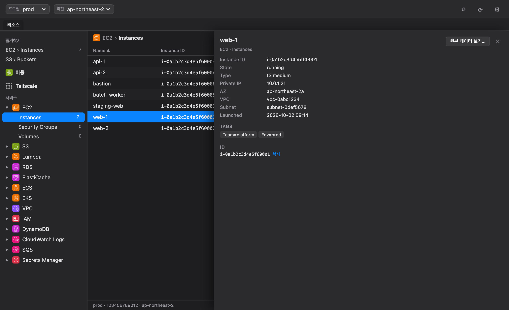

## Contents

- [Features](#features)
  - [Resource browser](#resource-browser-read-only) · [VPC network diagram](#vpc-network-diagram) · [IAM workspace](#iam-workspace) · [Cost dashboard](#cost-dashboard)
  - [EKS (Kubernetes)](#eks-kubernetes) · [ArgoCD](#argocd) · [Argo Workflows](#argo-workflows) · [Tailscale connection check](#tailscale-connection-check) · [PostgreSQL users (RDS)](#postgresql-users-rds) · [Valkey and Redis OSS (ElastiCache)](#valkey-and-redis-oss-elasticache)
  - [S3 explorer](#s3-explorer) · [File diff](#file-diff) · [Auto-update](#auto-update)
- [What can change things](#what-can-change-things)
- [Settings](#settings)
- [Keyboard shortcuts](#keyboard-shortcuts)
- [What the app stores](#what-the-app-stores)
- [Install](#install) · [Requirements](#requirements)
- [Development](#development) · [Releasing](#releasing)

## Features

### Resource browser (read-only)

- **17 services, 27 resource types**:

  | Service | Resource types |
  | --- | --- |
  | EC2 | Instances, Security Groups, Volumes |
  | S3 | Buckets |
  | Lambda | Functions |
  | RDS | DB Instances, DB Clusters |
  | ElastiCache | Replication Groups, Cache Clusters, Serverless Caches |
  | ECS | Clusters, Services, Tasks |
  | EKS | Clusters, Node Groups |
  | VPC | VPCs, Subnets |
  | IAM | Users, Roles, Policies |
  | DynamoDB | Tables |
  | CloudWatch Logs | Log Groups |
  | CloudFront | Distributions |
  | SQS | Queues |
  | SNS | Topics |
  | ECR | Repositories |
  | Route 53 | Hosted Zones |
  | Secrets Manager | Secrets |

  S3, IAM, CloudFront, and Route 53 are global; the rest follow the selected region.
- Uses the profiles in `~/.aws/config`, including SSO. Pick a profile and region and the list loads. The last profile and region are remembered.
- **SSO sign-in**: when an SSO session has expired — when you pick the profile, when the app starts, or while you work — the app runs `aws sso login` for you. Approve it in the browser that opens and the lists reload. A banner shows the progress and lets you cancel. Profiles that share an SSO session sign in once, and role profiles sign in through their `source_profile`. The same sign-in starts when an EKS kubeconfig context or an Argo Workflows connection hits an expired session.
- **Sidebar**: services in the official AWS Architecture icon set, with a count per resource type. Turn on only the services you use (Settings → 표시할 서비스), and pin resource types as favorites; favorites sit at the top. Under each service the resource types run from the largest unit down, clusters first (RDS: DB Clusters before DB Instances; ElastiCache: Replication Groups, Serverless Caches, then Cache Clusters, which are the groups' nodes). Drag favorites, services (by their name row), and the rows under a service to put them in your own order; the order is kept across restarts. **💰 비용** opens the cost tab, **IAM → 🔐 IAM 관리** the IAM workspace, and **EKS → 🐙 ArgoCD** / **⚙️ Argo Workflows** those tabs.
- **Detail panel**: key fields, tags, raw JSON, a link to the AWS console, and ID copy (⌘C). It opens as an overlay over the list; click the selected row again or an empty spot to close it. An EKS cluster's detail also shows its usage summary. Double-clicking opens a workspace for some types: a bucket opens the S3 explorer, a VPC its diagram, an IAM user, role, or policy the IAM workspace, an EKS cluster the EKS tab, an RDS PostgreSQL cluster or instance the PostgreSQL tab, and a Valkey or Redis OSS cache the `⚡` tab.
- **Fuzzy filter (⌘F)**: type letters in order, skipping any — `poa` finds `prod-orders-api`. Space-separated words must all match. In the resource list it looks at the name, ID, text columns, and tags (`team=pay`); matched letters are highlighted. While filtering, the best matches come first until you click a column header. The same filter works on the other tabs (IAM, PostgreSQL, ArgoCD, Kubernetes, S3 explorer).
- **Find anything you've opened (⌘K)**: searches every list this profile has read, in every region, without calling AWS. Words can also match the service, type, or region (`west web`). Pick a result to jump to its region and type with the row selected. Results show how old the list is; lists past the cache TTL are marked and reload when opened.
- **Caching**: lists stay cached while the app runs and reload in the background when you reopen one older than the cache TTL (Settings → 리소스 캐시: 5 min, 15 min, 1 h, 6 h, or unlimited; default 15 min). ⌘R refreshes what's on screen. **캐시 비우기** or ⌘⇧R drops every cached list for all profiles and regions, on disk too, and reloads what's on screen.
- The ⌘K index is kept on disk for 7 days (`resource-index.json` in the app data folder, readable only by you). It holds only names, IDs, column values, and tags — never raw JSON or detail fields, which can contain secrets such as Lambda environment variables.
- Read-only: it never calls APIs that change resources, and it never reads Secrets Manager secret values.
- **Appearance**: light, dark, or follow the system (the default). Scrollbars take no room: a thin bar appears over the content only while you scroll (drag it to scroll), even when macOS is set to always show scroll bars.
- **Navigation**: tabs for every open workspace; ⌘[ / ⌘] and the mouse back/forward buttons move through history inside a tab.

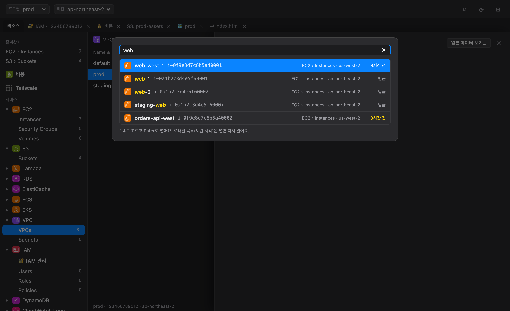

### VPC network diagram
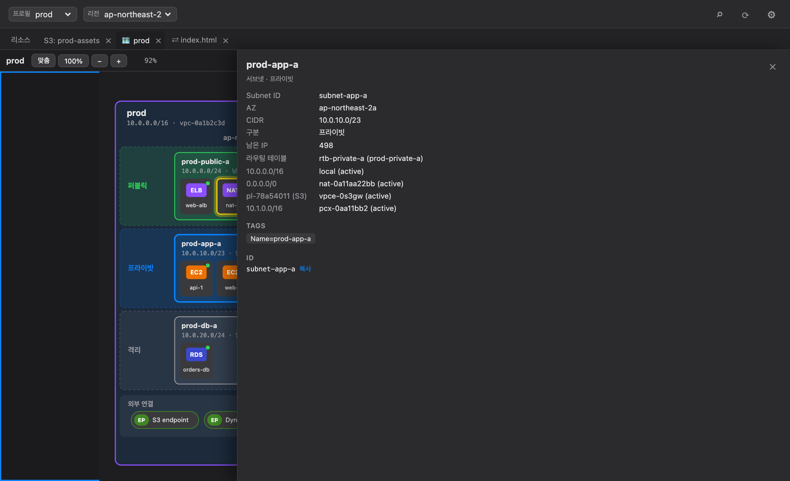

- Double-click a VPC in **VPC → VPCs** to draw its network in a new tab, laid out like an AWS architecture diagram: Availability Zones as columns, public / private / isolated subnets as rows.
- Subnet tiers come from the route tables: a default route to an internet gateway means public, any other default route means private, and no default route means isolated.
- Shows EC2 instances, NAT gateways, load balancers, RDS, Lambda functions, and interface endpoints inside their subnets. Internet, egress-only, and VPN gateways sit on the VPC border. Gateway endpoints, Transit Gateway attachments, and peering connections sit in the bottom band.
- Click a subnet to see its route table and highlight where its default route goes. Click any resource for details and a console link.
- Zoom and pan, and save the diagram as a PNG. Like every diagram and graph in the app, it takes the wheel and dragging only after you click it (an accent outline shows it's grabbed); until then the wheel scrolls past it, and clicking or tabbing elsewhere lets go.
- Anything the profile can't read is skipped with a warning instead of failing the diagram.
- Opened from an EKS cluster's **🌐 네트워크** screen, the cluster's nodes and load balancers are outlined in pink; **강조 끄기** in the bar turns that off.

### IAM workspace
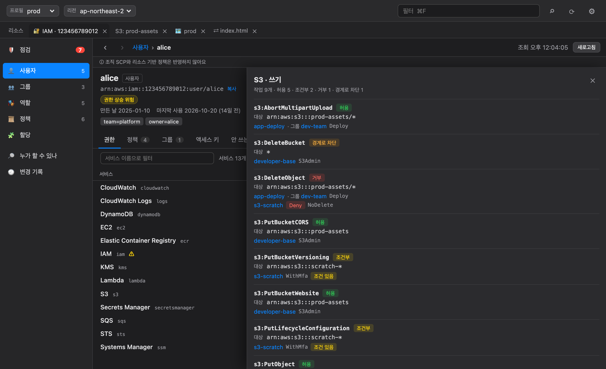

Open **IAM → 🔐 IAM 관리** in the sidebar, or double-click a user, role, or policy in the resource list, to get one tab for the whole account.

- **Principals and policies**: lists of users, groups, roles, and policies. A principal's detail shows its permissions, attached and inline policies, group memberships, access keys, and (for roles) the trust policy and who can assume it. A policy's detail shows its document, versions, and where it's attached.
- **Effective permissions**: for every user, group, and role, a table of services × access levels (list, read, write, permissions management, tagging). It combines attached and inline policies, group policies, permissions boundaries, Deny statements, and conditions. Click a cell to see each action, the resources it covers, and the policy statement that allows or blocks it.
- **Who can do this?**: enter an action such as `s3:DeleteObject`, optionally with a resource ARN, to list every user and role that can perform it and why. You can check the results against the IAM policy simulator.
- **Security checks**: root access keys and MFA, console users without MFA, old or unused access keys, inactive users and roles, admin-level principals, privilege-escalation paths, roles that other accounts or anyone can assume, and policies attached nowhere. Each finding links to the principal, and an old or unused access key can be deactivated right from its finding, through the same preview as any other change.
- **Unused permissions**: uses IAM last-accessed data to show the services a user or role hasn't used, suggest policies to detach, and draft a narrower policy from what was actually used. The draft never allows more than the principal can do today: it leaves out conditional allows and keeps existing Deny statements.
- **Changes from the app**:
  - Attach or detach managed policies, add or remove group members, and create, edit, or delete inline policies.
  - Save a new version of a customer managed policy.
  - Deactivate, reactivate, or delete access keys.
- **Preview before every change**: every change starts with a preview of the exact API calls, who gains or loses which permissions, and any warnings. Risky changes ask you to type the target's name or key ID: granting admin access, cutting off the app's own access, adding or removing a policy whose document couldn't be read, or any change to the app's own access while such a policy is involved. Other unreadable policies are shown as a warning. (For a profile that assumes a role through `source_profile`, the source profile's access key isn't recognized as the app's own key.) When you apply, the app recomputes the change and stops if it no longer matches the preview you confirmed. Service-linked and IAM Identity Center roles are managed by AWS and can't be changed.
- **Assignment matrix** (🧩 할당): two tables, principals × managed policies and users × groups. Click a cell, drag across cells, or use the keyboard (arrows, Space, Shift+arrows for a range, ⌘Home / ⌘End for the corners) to queue attaches, detaches, and membership changes in a tray of up to 50. Cells a principal only gets through a group show which group grants them and can't be toggled. "다른 주체와 같게" copies another principal's policies or groups; removals are opt-in. The tray is previewed as one batch: per-change API calls, the combined permission changes, and one confirmation if anything is risky. Applying goes change by change, grants first, and stops at the first failure, keeping what was already applied and offering to undo it.
- **Change log**: every applied change is recorded locally (`iam-changes.jsonl`), and most can be undone. An undo goes through the same preview. Changes AWS can't reverse, such as deleting an access key, are marked as such. A batch from the assignment matrix shows as one group and can be undone as a whole. If a change was applied but couldn't be written to the log, a note says so until you dismiss it.
- **What it doesn't evaluate**: only identity-based policies and permissions boundaries. Organization SCPs and resource-based policies (such as bucket policies) aren't included, and the app says so on screen.

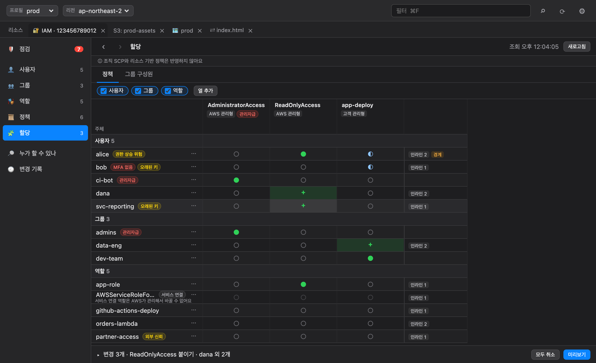

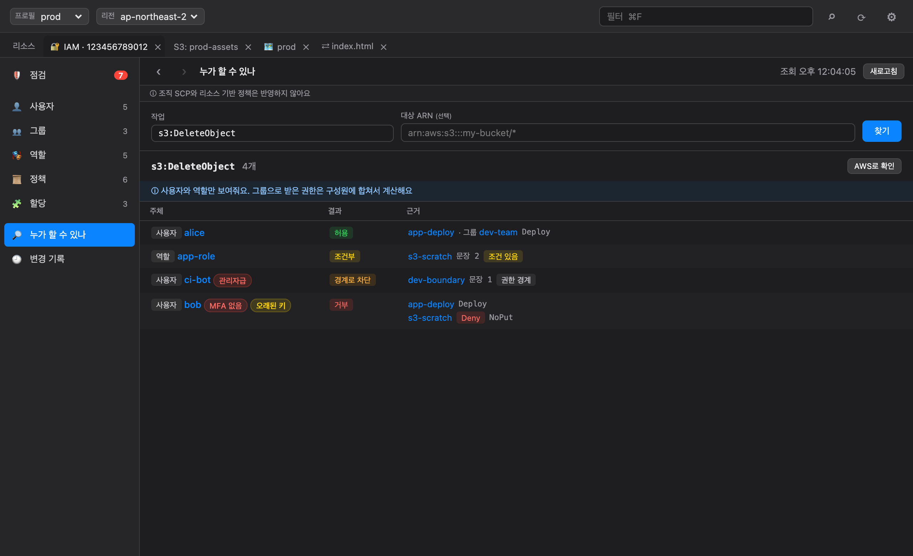

### Cost dashboard
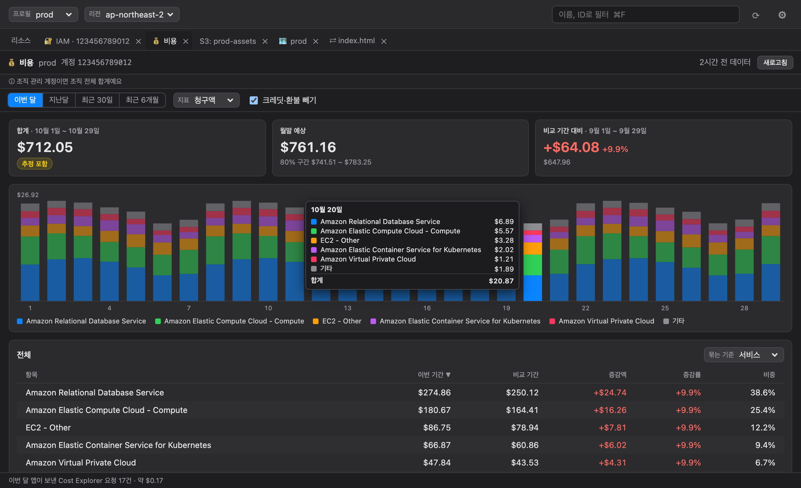

Click **💰 비용** at the top of the sidebar to open one tab with the costs of the profile's account, from AWS Cost Explorer.

- **Periods**: this month (the default), last month, the last 30 days, and the last 6 months by month. Each period is compared with the one before it automatically (this month so far against the same days of last month). Pick billed cost (`UnblendedCost`) or amortized cost, and leave credits and refunds out (on by default).
- **Summary**: the period's total, marked when it includes AWS estimates; this month's forecast with its 80% range; and the change against the compare period.
- **Daily trend**: stacked bars for the top 5 services and everything else. Hover a bar to see that day's amounts.
- **Breakdown**: by service, region, usage type, or an active cost allocation tag, with this period, the compare period, the change, and the share. Click a row to drill down (service → usage type, region or tag value → service); the filter applies to the whole screen, and the path above the table goes back up. Items under half a cent fold into one row.
- **Requests cost money**: Cost Explorer charges $0.01 per request. Answers are cached on disk for 6 hours (`cost-cache.json`), so reopening the same view is free. ⌘R (or **새로고침**) on the cost tab skips the cache for what's on screen; ⌘R on other tabs doesn't touch cost data. The bottom line shows how many requests the app sent this month and what they cost.
- Read-only, single account. Opened with an Organizations management account, the numbers are the whole organization's, and the tab says so.

### EKS (Kubernetes)

Double-click a cluster in **EKS → Clusters**, or press **EKS 탭에서 열기** in its detail, to open a `☸️ <cluster>` tab. Opening the same cluster again brings back its tab. The app talks to the Kubernetes API directly through your kubeconfig — `kubectl` isn't needed.

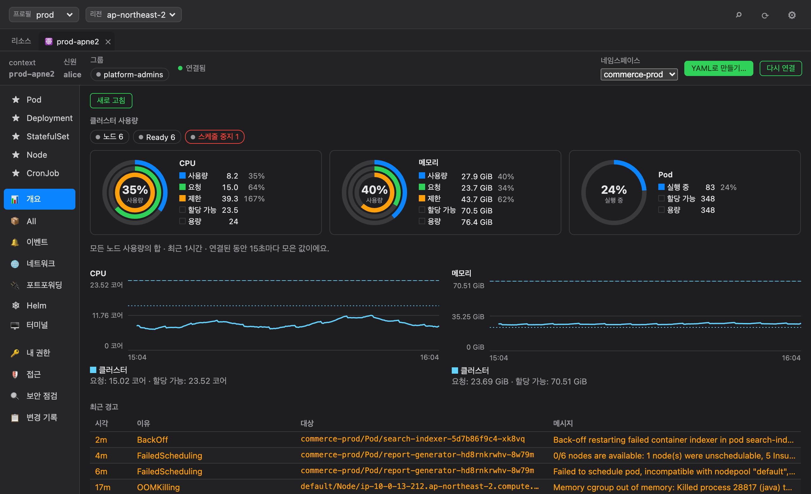

**Connecting**

- The kubeconfig comes from Settings → kubeconfig 경로, else `KUBECONFIG` (several files separated by `:`), else `~/.kube/config`.
- The app reads the cluster with `eks:DescribeCluster` and picks the context whose cluster is that ARN or whose server is that endpoint. With several candidates you choose one, and the choice is remembered per cluster. With none, the tab shows the `aws eks update-kubeconfig --name … --region … --profile …` command to copy.
- The context's exec plugin (usually `aws eks get-token`) runs with your login shell's `PATH`, so Homebrew-installed tools are found even though the app is started from Finder. If the kubeconfig signs in with a different AWS profile than the one picked in the app, a chip says so. An expired SSO session starts the usual SSO sign-in and the tab reconnects afterwards.
- The top bar shows the context, connection state, your identity (from `SelfSubjectReview` on Kubernetes 1.28+, otherwise the kubeconfig user name), a namespace picker, **다시 연결**, and **YAML로 만들기**.
- Closing the tab, or switching to another profile, closes everything it opened: watches, log streams, shells, and port-forwards.

**Navigating**

- The left menu holds bookmarks (drag to reorder), then **📊 개요**, **📦 All**, **🔔 이벤트**, **🌐 네트워크**, **🔌 포트포워딩**, **⎈ Helm**, **🔑 내 권한**, **🛡 접근**, **🔍 보안 점검**, and **📋 변경 기록**. The lanes can be resized, and the widths are remembered.
- **All** lists every kind the cluster serves, grouped into workloads, network, config, storage, access control, cluster, and custom resources (CRDs). Star a kind to bookmark it.
- **Lists** update live over watch streams (a stream stays open 30 s after you leave a kind, so going back is instant). Filter by fuzzy name or a label selector (`app=web,tier!=db`, `in`, `notin`), or tick **문제 있는 것만**. Each kind has its own columns (ready, status, restarts, node, IP, replicas, completions, schedule, IRSA role, …), and problem badges flag things like `CrashLoopBackOff`, `ImagePullBackOff`, `OOMKilled`, pending pods, or unready workloads.
- **이벤트** is a live event list with a Warning filter. **내 권한** shows your RBAC rules per namespace from `SelfSubjectRulesReview`; buttons you lack rights for are disabled and say which verb and resource are missing.

**Overview**

- A Lens-style cluster summary: node counts (ready, not ready, cordoned, under pressure), rings for CPU, memory, and pods (usage, requests, and limits against allocatable), a one-hour cluster usage graph, the top namespaces by CPU and memory, and the latest Warning events.
- Cluster settings from EKS: version and platform version, public/private endpoint and allowed CIDRs, control-plane logging, secrets encryption, OIDC provider, and authentication mode. Nodes with instance type, zone, and how they're managed (managed node group, Fargate, Karpenter, self-managed), node groups, Fargate profiles, and add-ons with their latest available version.
- **Upgrade checks**: EKS upgrade insights, objects that use APIs removed in the next Kubernetes versions, and kubelet version skew between the control plane and nodes.
- The same usage summary also appears in the cluster's detail in the AWS resource browser once a context has been chosen.

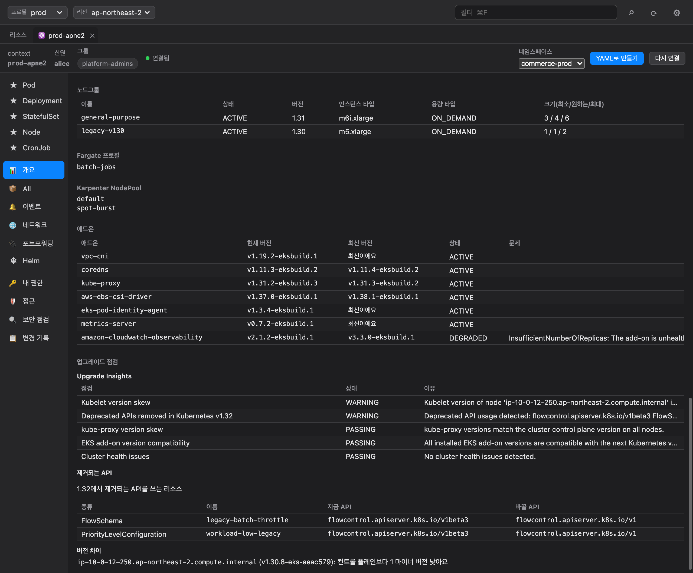

**Usage from metrics-server**

- While a tab is connected, the app samples metrics-server every 15 s and keeps the last hour in memory only (closing the tab or the app drops it).
- Pod lists get CPU and memory columns plus percent of request and limit, each drawn as a small trend chart with the number inside; node lists get usage against allocatable. Values over 90% are highlighted. Workload and namespace rows show sums.
- Pod, workload, and node details show usage graphs right below the basics. Without metrics-server, or without rights to read it, a note says so instead.

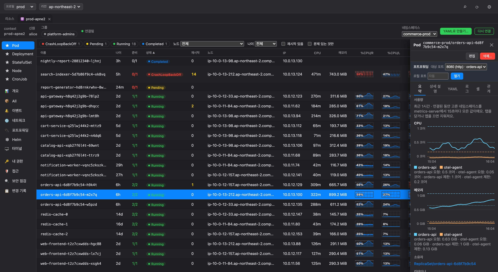

**Object detail**

- **요약**: labels and annotations (long values and `last-applied-configuration` fold; expanded JSON is highlighted), owners and owned objects (click to move between them), conditions, events, containers with state, restarts, and last termination reason. An IRSA role links to the IAM workspace.
- **YAML**: highlighted, with server-managed fields left out. Secret values are shown as `••••`; press **값 보기** on a key to read just that value. Values are kept only in the screen that shows them, never in a cache.
- **로그** (pods and workloads): a workload merges the logs of its pods (up to 40) with a color per pod. Choose a container or all containers, the previous container, how far back (5 min to 24 h, or everything), and how many lines to start with; follow, pause, search with match counts, timestamps, and line wrap. **JSON 정리** turns JSON log lines into one line each (time, level, message) with the fields folded, and the level chips (오류, 경고, 정보, 디버그, 기타) filter them; **원문** keeps the raw text with ANSI colors. The last 50,000 lines are kept. **저장** writes what's shown to `~/Downloads/<name>-<time>.log`.
- **셸** (pods): an in-app terminal. **셸 (새 프로세스)** runs bash, or sh when bash isn't there; **attach (주 프로세스)** attaches to the container's main process, with a warning that input and Ctrl-C go to it (output only unless the container has `stdin` and `tty`). Sessions stay open while you look at other tabs. Terminal input and output are never recorded; only when a session opened and closed, and on what, goes to the change log.
- **Port-forward** (pods and services): pick a declared port or type one, and a local port or leave it automatic. The app listens on `127.0.0.1` only. A service forward follows the service: if its pod goes away, it switches to another ready pod (waiting up to 15 s). Each forward has **브라우저로 열기**, **주소 복사**, and **종료**; **포트포워딩** in the menu lists them all.

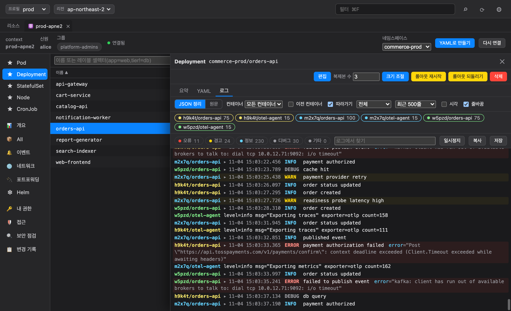

**🌐 네트워크** (read-only)

- **로드밸런서**: every `LoadBalancer` Service and Ingress next to its ALB or NLB, matched by DNS name first and then by the AWS Load Balancer Controller's tags, with listeners and target health (`정상 N · 비정상 M`). The detail shows listener rules and target groups; unhealthy targets show their reason, and target pods and nodes link to the workload screens. Services without an address, load balancers ELBv2 doesn't know (such as Classic), and load balancers tagged for this cluster that nothing points at are listed as such.
- **노드·서브넷**: each node's instance, zone, and subnet, and the cluster VPC's subnets with free IPs. **Pod IP** counts pods per subnet on VPC CNI clusters (host-network pods show as 노드 IP). **NetworkPolicy** summarizes each policy's ingress and egress rules and lists namespaces without one.
- **VPC 다이어그램 열기** opens the cluster's VPC diagram with its nodes and load balancers highlighted; **VPC 다이어그램에서 보기** in a load balancer's detail highlights just that one. Anything AWS doesn't let the profile read is listed at the top with the reason, and the Kubernetes side still shows.

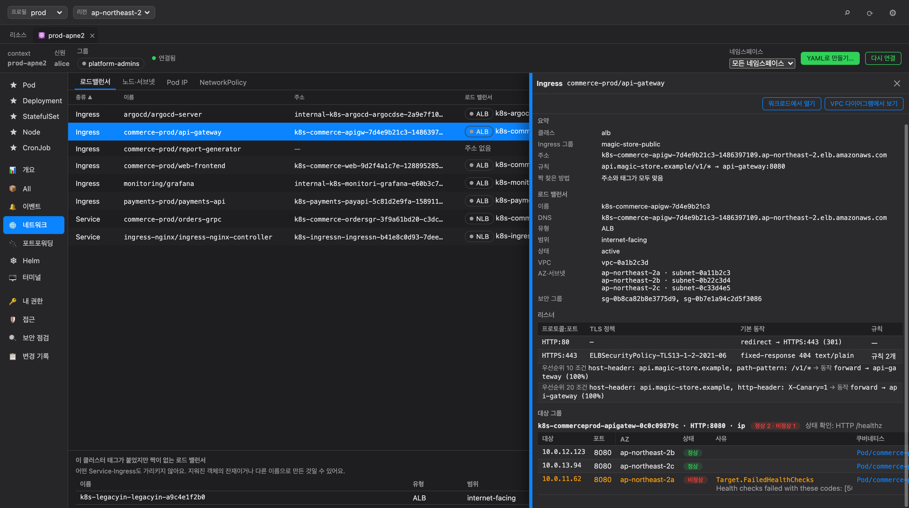

**⎈ Helm**

- Releases in the selected namespace (or all), one row per release at its latest revision, with status badges (deployed, failed, pending-*), chart, app version, and revision; refreshed every 10 s. **문제 있는 것만** narrows to failed and pending ones.
- The detail has **요약** (chart, resources the release made — click to open them — hooks, dependencies), **values** (**사용자가 준 값** and **계산된 값**, like `helm get values` and `helm get values --all`), **매니페스트** (Secret values masked), **이력** (view an old revision read-only, or roll back to it), and **notes**.
- **업그레이드** edits the values (they replace the user values, `--reset-values`) or switches to another chart from a repository, an OCI address, or a local path. **롤백** picks a revision. **삭제** lists everything it removes and can keep the history (**이력 남기기**). **차트 설치** takes a release name, namespace (optionally created), chart location, and values, with **차트 기본값 불러오기** to start from the chart's defaults.
- Every one of these renders with `helm … --dry-run=server` first and previews the object-by-object field changes and the values diff. Releases in `kube-system` or with `prod` in the name need it typed, and uninstalling always does. A release that changed after the preview stops the apply.
- Reading works without `helm`; changes need `helm` 3.13 or later on your login shell's `PATH`, and are disabled with the reason otherwise.

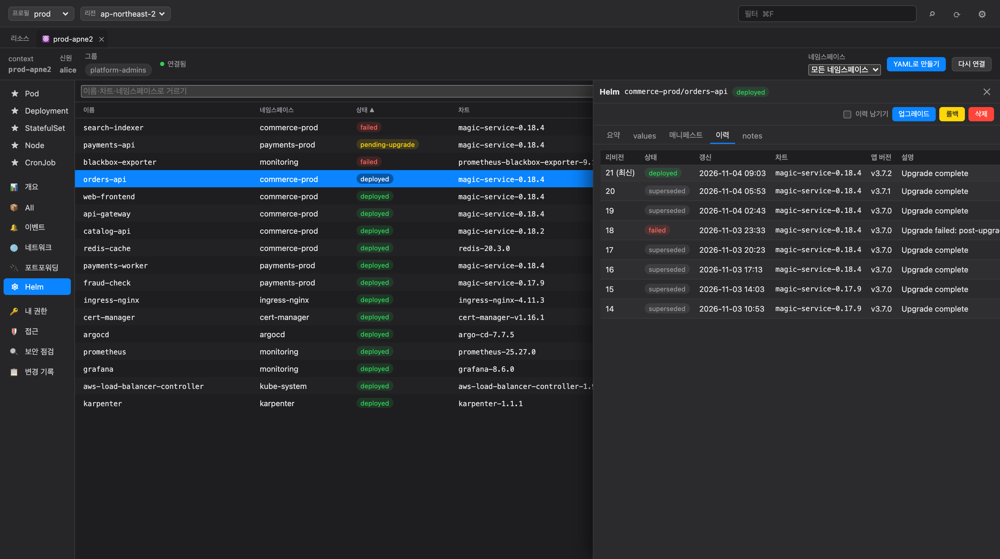

**🛡 접근**

- **신원**: the cluster's authentication mode and who gets in through access entries and the `aws-auth` ConfigMap, with their Kubernetes user names, groups, and access policies. Entries the mode ignores, or that an access entry for the same principal overrides, are dimmed. `AWSReservedSSO_*` roles fold into one row per permission set (**SSO 권한 세트로 묶기**), and **IAM에서 열기** opens a role in the IAM workspace.
- **권한 표**: subjects (IAM principals, users, groups, ServiceAccounts) × cluster-wide and up to 8 chosen namespaces, 25 rows a page. Seven cells per column — read, write, delete, exec/attach/port-forward, Secret read, RBAC changes, privilege escalation — each all, some, or none. Click a cell for the actions checked and the binding path (binding → role → aggregated ClusterRole, or the access policy). It evaluates RBAC and EKS access policies, including `aggregationRule`, wildcards, `resourceNames`, subresources, and default groups, and says so on screen.
- **누가 할 수 있나**: a verb, resource, namespace, and optional name — or a preset such as Secret read, pod exec, or impersonation — lists every subject that can, with its path. Permissions from default groups like `system:authenticated` show on that group's row only. **클러스터에 대조(SubjectAccessReview)** checks up to 100 results against the API server and marks any that differ.
- **워크로드 신원**: ServiceAccounts with IRSA roles and Pod Identity associations, the pods using them, and whether the role's trust policy actually lets this cluster's OIDC provider and ServiceAccount assume it (동작해요, 연결돼 있지만 동작하지 않음, or 확인하지 못함).
- Parts AWS or Kubernetes won't let you read are listed at the top; the rest still shows.

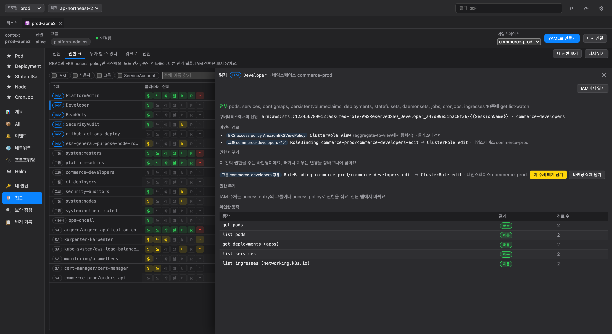

**🔍 보안 점검**

- Checks across the cluster (public endpoint open to `0.0.0.0/0`, control-plane logging off, no secrets encryption, standard support ending within 90 days, `aws-auth` in use, the creator's admin access entry), RBAC (cluster-admin and `system:masters` subjects, grants to anonymous or all authenticated users, bind, escalate, impersonate, `nodes/proxy`, cluster-wide Secret read, pod creation with a powerful ServiceAccount, unused roles, bindings to missing roles or ServiceAccounts), and workloads (privileged, `hostPath`, host network or PID, root, `allowPrivilegeEscalation`, missing requests, limits, or probes, `latest` or untagged images, default ServiceAccount token automount, namespaces without a NetworkPolicy, node groups with IMDS hop limit 2 or more).
- Cards count findings by severity (높음, 중간, 낮음) and category and filter the list when clicked. System namespaces (`kube-system`, `kube-public`, `kube-node-lease`, `amazon-*`) are hidden until **시스템 네임스페이스 포함**; **점검 항목** turns checks off for every cluster; **점검 항목별로 묶기** groups the list.
- A finding's detail shows the evidence, why it matters, and how to fix it, with links to the object, the IAM role, or the access screen. **자동으로 고치기** fixes what's safe to fix from the app (`allowPrivilegeEscalation` left unset, default ServiceAccount token automount) through the usual change preview, and warns when Helm or ArgoCD manages the object. AWS-side findings (cluster, node groups) say to fix them in AWS.

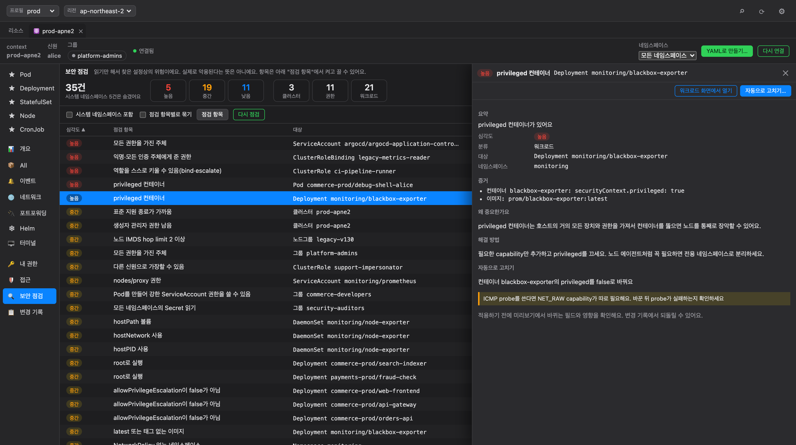

**Changes**

The buttons sit in the top-right toolbar of a detail and are disabled, with the reason, when your RBAC doesn't allow them.

| Target | Actions |
| --- | --- |
| Deployment, StatefulSet | 크기 조절 (scale), 롤아웃 재시작, 롤아웃 되돌리기 (to a chosen revision) |
| DaemonSet | 롤아웃 재시작, 롤아웃 되돌리기 |
| CronJob | 바로 실행 (creates a Job), 일시정지, 재개 |
| Job | 재실행 (creates a new Job from its spec) |
| Node | 스케줄 중지 / 재개 (cordon), drain, 노드 셸 |
| Any object | 편집 (YAML), 삭제 |
| New objects | **YAML로 만들기** in the top bar |
| RoleBinding, ClusterRoleBinding | 주체 추가 / 빼기, 삭제 — also from a 권한 표 cell's **권한 바꾸기**: remove a subject, delete the binding, or grant a ClusterRole |
| Access entry (🛡 접근 → 신원) | Create, change Kubernetes groups, associate or disassociate access policies, delete |
| Helm release (⎈ Helm) | 업그레이드, 롤백, 삭제, 차트 설치 |
| Security finding (🔍 보안 점검) | 자동으로 고치기 |

- **Preview first**: every change opens a preview with the exact API calls and bodies, field-by-field before and after, impact, and warnings, after a server-side dry run. Objects in `kube-system`, or with `prod` in their name or namespace, need their name typed to apply (the same rule guards opening a shell or attach). If the object changed after the preview, applying stops and asks for a new preview. Rollouts show their progress after a restart or scale.
- **YAML edit and create** use server-side apply as `magic-mirror`. A conflict with another field manager shows the fields and their owners and blocks the apply; **강제 적용으로 다시 미리보기** takes them over and needs the name typed. Editing the `aws-auth` ConfigMap adds a warning. A Secret is edited key by key: read a value to change it, type a new one, or add a key; keys you don't touch are kept. **YAML로 만들기** takes up to 50 documents separated by `---`, applies them in order, stops at the first failure, and offers to undo what was already created.
- **Drain** cordons the node, then evicts pods one at a time with live progress. DaemonSet, mirror, and already-terminating pods are skipped; pods with `emptyDir` data or without a controller are flagged first. Evictions blocked by a PodDisruptionBudget are retried, and the drain stops if one blocks for 5 minutes. **중단** stops after the current eviction; pods already moved stay moved.
- **Node shell** creates a privileged debug pod pinned to the node (default image `busybox:1.36`, editable) in the selected namespace, enters the host with `nsenter`, and deletes the pod when you close the session, the tab, or the app. It always needs the node name typed.
- **RBAC cart**: binding and access entry changes can go to a per-cluster cart (**장바구니 N/50**) that survives moving between screens. **한 번에 미리보기** shows each change's calls and diff and, for the whole batch, who gains and loses which permissions. Granting cluster-admin, touching `kube-system` or `prod`, associating `AmazonEKSClusterAdminPolicy`, changing your own access entry, or anything that takes permissions away from you needs the name typed. The batch is re-planned right before applying and nothing runs if it differs; applying stops at the first failure and offers **적용한 것 되돌리기**.
- **Change log and undo**: every change is recorded locally (`k8s-changes.jsonl`). Scale, cordon, suspend, YAML apply and create, run-now and re-run Jobs, deleting an object without an owner, binding and access entry changes, security fixes, Helm installs (undone by uninstalling), upgrades (by rolling back), and uninstalls that kept their history can be undone through the same preview. Restarts, rollout undos, deleting a pod or an owned object, any Secret change, and uninstalls without history can't, and are marked as such. Helm values are never written to the log.

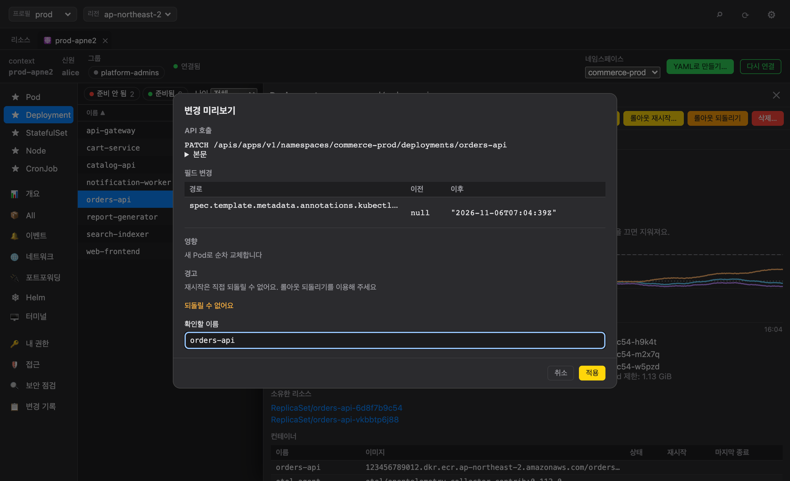

### ArgoCD

Open **EKS → 🐙 ArgoCD** in the sidebar for a single tab that talks to ArgoCD API servers. It doesn't depend on the AWS profile and stays open when you switch.

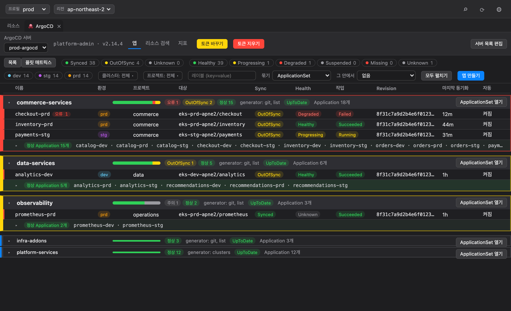

- **Connecting**: add a server in two steps — its address (the same one you open the ArgoCD web UI with), then an API token (from Settings → Accounts → Tokens in the ArgoCD UI, or `argocd account generate-token`). The token is kept in the macOS keychain only. `http://` servers get a plaintext warning. Several servers can be added; **서버 목록 편집**, **토큰 바꾸기**, and **토큰 지우기** manage them, and removing a server forgets its token. The top bar shows who you are and the server version.
- **Applications**: refreshed every 10 s while the tab is shown. Filter by sync state (Synced, OutOfSync, Unknown), health (Healthy, Progressing, Degraded, Suspended, Missing, Unknown), environment, target cluster, project, and labels (`key=value`; the same key ORs, different keys AND), plus fuzzy search over name, namespace, and labels. Filters and grouping are remembered per server.
- **Environments** (dev, stg, prd, ops, demo, preview) are inferred in this order: a `preview=true` label, an `environment` or `env` label, the app name, its namespace, then its target cluster. Apps that match nothing are 미분류.
- **Grouping**: two levels, by ApplicationSet, environment, target cluster, project, namespace, or a label. ApplicationSet groups are cards marked by their worst app, with a tally bar and chips (오류, OutOfSync, 주의, 정상), their generators, and their own errors.
- **Problems first**: groups go red, then yellow, then healthy; inside a group the worst apps come first. Healthy cards fold to a thin line, and healthy apps in a mixed group fold to one green line naming them. **모두 펼치기** and **정상 접기** switch everything at once.
- **Application detail**: **개요** (sync and health, revisions, the last operation and its failed resources, conditions, Git and Helm sources, destination, sync policy, images), **리소스** (the resource tree with health, sync state, hooks, and resources about to be pruned), **이력** (the last 20 deployments), and **YAML/JSON**.
- **Actions**: **Refresh**, **Hard refresh**, and **Sync…**, which asks first and offers **Prune** and **Dry run** (both off by default). Sync is disabled while an operation is running. ArgoCD's RBAC decides what the token may do.

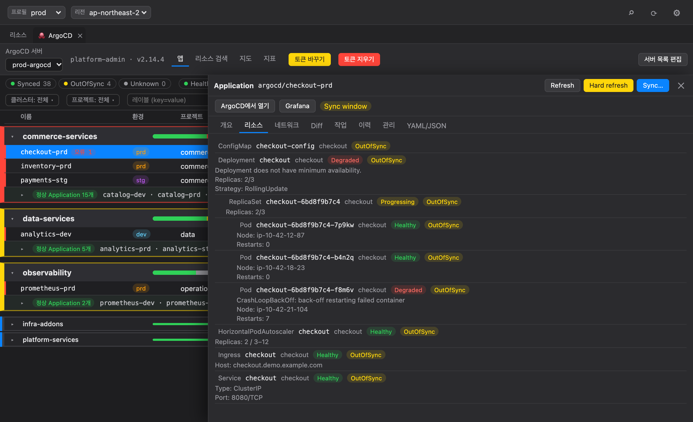

### Argo Workflows
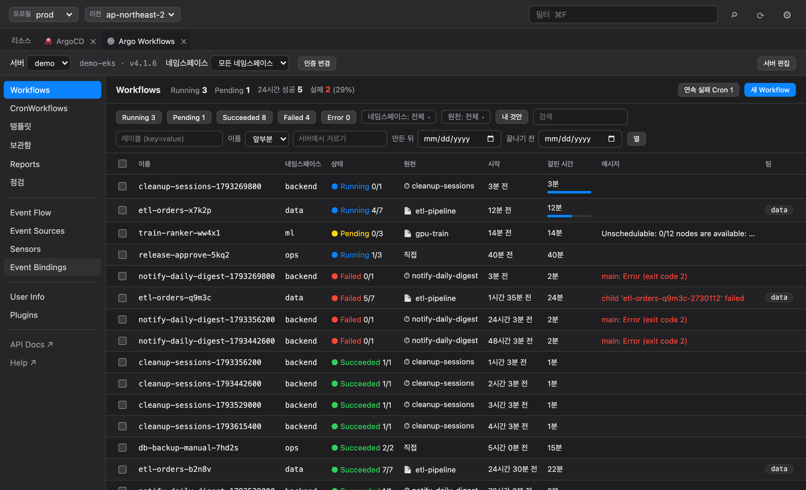

Open **EKS → ⚙️ Argo Workflows** in the sidebar for a single tab that doesn't depend on the AWS profile. It talks to a running Argo Server API.

- **Connecting**: add the server URL, then pick how to sign in. With a **kubeconfig context**, the app uses that context's credentials as the bearer token — for EKS, the `aws eks get-token` exec plugin, so you act as the same identity as `kubectl`. This needs the server to run with `--auth-mode=client`. If the context's SSO session has expired, the usual SSO sign-in starts. Or paste an **API token**; it's kept in the macOS keychain. `http://` servers get a plaintext warning.
- **Namespace**: the top-bar dropdown lists only namespaces that hold Argo resources (workflows, CronWorkflows, templates, event bindings), not every Kubernetes namespace. Pick one when your identity can't list every namespace (the app asks when the server says so); identities that can't see any get a field to type the name. A server running with a managed namespace locks it.
- **Workflows**: live updates over the server's watch stream (falls back to polling if it drops). Running and pending first, then recent failures. A summary band, phase chips, label filter, name filter (exact, prefix, contains), created-after and finished-before dates, namespace and source filters, **내 것만**, and fuzzy search; more pages load on demand. Extra columns from the server's `columns` setting or label columns you pick, a progress bar from the estimated duration, and links from the server's `links` setting. Select several rows to stop, terminate, suspend, resume, retry, resubmit, or delete them at once. **새 Workflow** opens a YAML editor with examples.
- **Workflow detail**: overview (parameters, global outputs, where it came from, mutex and semaphore waits, ServiceAccount and its IRSA role, deadline, pod GC, TTL, resource usage), a **graph** (zoom, horizontal or vertical, phase and type filters, artifact nodes), steps as a tree with timeline bars, logs (one pod or all, previous container, since, timestamps, save to file; logs of deleted pods from the archived `main-logs` artifact), Kubernetes events, and YAML. Node details show containers, host node, memoization, artifacts (preview text, JSON, or images; download), and node actions: retry just this node (with changed parameters), resume, stop, and for a suspend step, fill in its output values and continue. **실패 단계로** jumps to the step that actually failed. **Argo UI에서 열기**, link copy, status-badge and graph widget addresses, and **YAML로 고쳐 다시 제출**.
- **CronWorkflows** and **templates** (namespaced and cluster): schedules in words with the next 5 runs (time zones, `CRON_TZ=`, `@every`), the last 10 runs, missed runs; create, edit, and delete in the YAML editor (with server-side lint); run a template with parameters, entrypoint, labels, generate name, ServiceAccount, or a dry run. **보관함** lists archived workflows with the same filters.
- **Reports**: pick a label (a cron or template) to chart the latest 50 runs' duration, CPU, and memory, colored by result.
- **Argo Events**: **Event Flow** (event source → event → sensor → trigger → workflows it started), **Event Sources** and **Sensors** (details, YAML, logs, create, edit, delete), and **Event Bindings**. Without Argo Events on the cluster the screens say so.
- **점검**: crons failing 3 times in a row, missed runs, workflows running over an hour without a deadline or pending over 10 minutes, crons and templates without a deadline or on the `default` ServiceAccount.
- **Actions** ask first, and anything with `prod` in its name or namespace needs the name typed for stop, terminate, and delete. The Argo Server checks permissions.
- **User Info** (who you are to the server, and a token for the `argo` CLI copied to the clipboard), **Plugins** (executor plugin ConfigMaps), and **API Docs** and **Help** in the browser.
- Events, IRSA roles, and plugins need a kubeconfig context connection; they're read with the same identity through the Kubernetes API.
- Servers, their sign-in choice, namespace, label columns, and list filters are remembered per server.

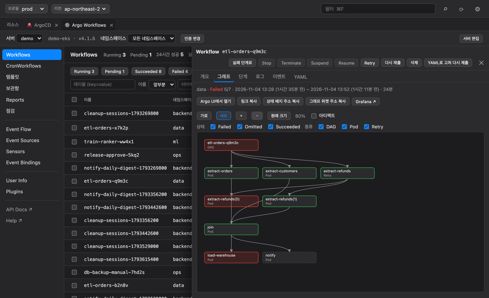

### Tailscale connection check

When the EKS, ArgoCD, or Argo Workflows tab can't reach its server, the error box gets a **Tailscale 진단** button. It runs the local `tailscale` CLI and checks, in order:

- the CLI, whether Tailscale is running and signed in (and any health warnings), and which tailnet this Mac is on
- whether the server's name resolves, including a MagicDNS name while **accept DNS** is off
- which tailnet device or subnet router carries the address (the longest matching approved route), whether this Mac accepts subnet routes, and whether that device is online
- a `tailscale ping` to the address (direct or through which DERP relay, and how fast), a TCP connection to the server's port, and whether UDP works here (`netcheck`)

The first failure becomes the conclusion. If subnet routes are off, **경로 받기 켜기** shows `tailscale set --accept-routes=true` and what it changes, runs it after you confirm, and checks again; **되돌리기** turns it back off. Nothing else is changed, and the tailnet itself (devices, policy, keys) isn't read through the API.

### PostgreSQL users (RDS)
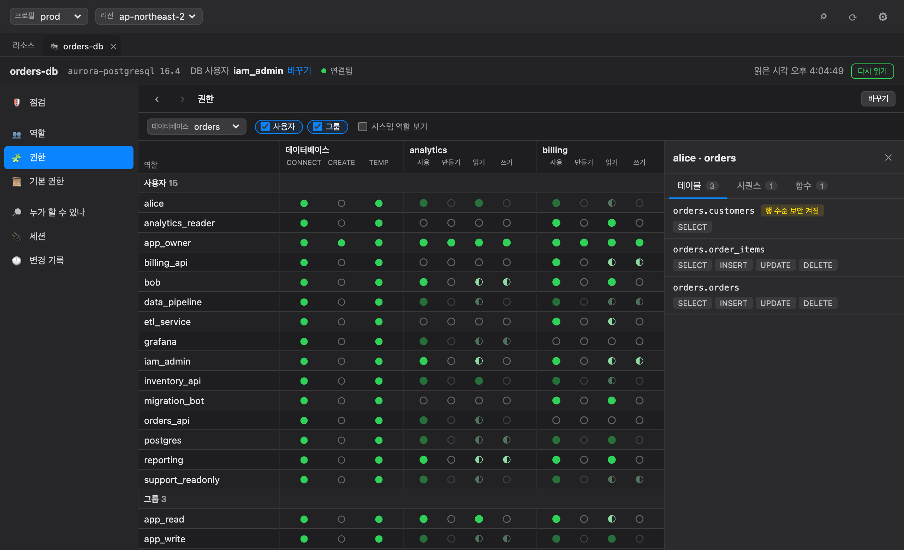

Double-click an Aurora PostgreSQL or RDS for PostgreSQL row in **RDS → DB Clusters** or **DB Instances** to open a `🐘` tab (an Aurora instance opens its cluster). The app asks which DB user to sign in as (remembered per cluster or instance), connects straight to the database over TLS, and signs in with an IAM authentication token. Reading is always read-only: every query that looks at the database runs in a read-only transaction. Changes are made only when you press **Apply** on a preview (see below). Closing the tab closes its connections.

- **Roles**: users and groups, with system roles hidden until you ask. Badges mark admin-level roles (`rds_superuser` members), IAM sign-in, CREATEROLE, CREATEDB, BYPASSRLS, REPLICATION, and logins that are expired or about to expire. A role's detail shows its attributes, per-role settings, memberships (including ones that don't inherit), privileges and owned objects per database, and its sessions.
- **Privileges**: a roles × schemas table for one database, with USAGE, CREATE, and table read/write coverage per cell, plus CONNECT, CREATE, and TEMP on the database itself. It counts what a role gets from ownership, direct grants, groups, PUBLIC, and predefined roles such as `pg_read_all_data`, and flags privileges a role can't actually use because it lacks CONNECT or USAGE. Click a cell to see each object's privileges and where each one comes from.
- **Default privileges**: what new objects will get (`ALTER DEFAULT PRIVILEGES`), written out as sentences.
- **Who can do this?**: pick an object and a privilege to list the users and groups that have it, with the path that gives it to them (for example `alice ← app_write ← app_read ← direct grant`).
- **Sessions**: current connections with role, database, client, application, state, start time, and wait event. The app's own connections are marked. Details of other users' sessions need `pg_read_all_stats`, and the app says so when they are hidden.
- **Security checks**: PUBLIC with CREATE on a schema or privileges on tables, `rds_superuser` members, CREATEROLE, BYPASSRLS, expiring logins, login roles with no group and no privileges, gaps in default privileges, SECURITY DEFINER functions without a fixed `search_path`, and `md5` password encryption. Each finding links to the role or to the privileges table. Password hash types and last logins aren't visible on RDS, so they aren't checked, and the app says so.

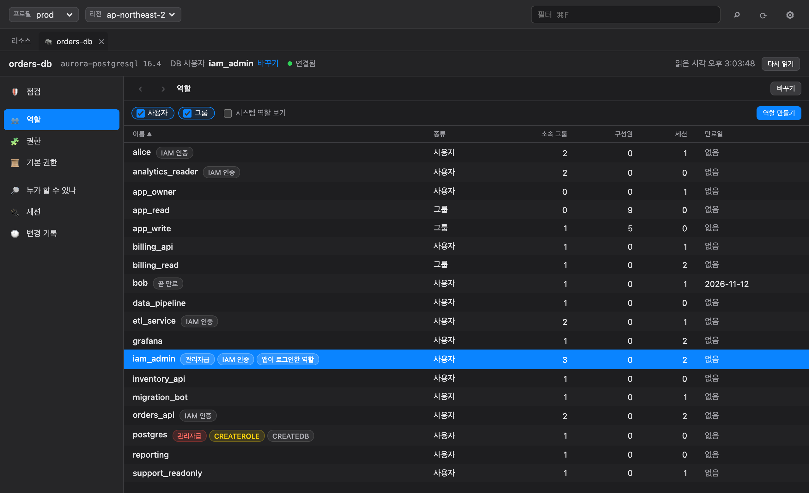

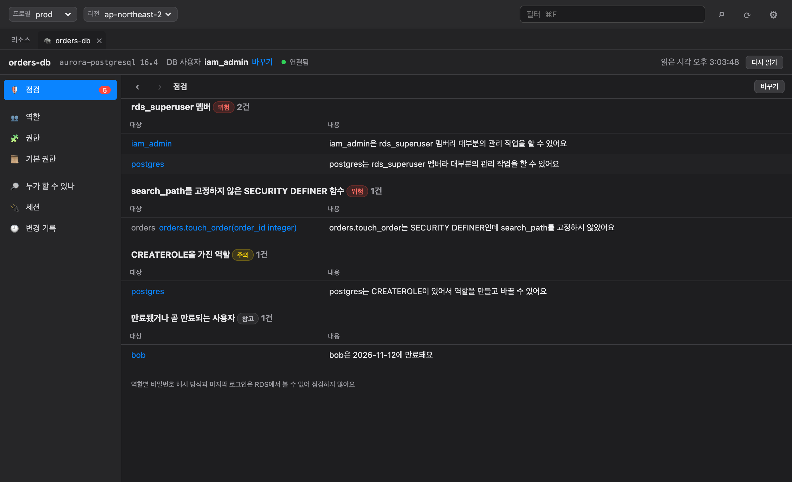

#### Changing roles and privileges

Turn on **Change** in the bar above a screen to edit. You can:

- **Create a role** (a user or a group), optionally with a preset (read-only, read-write, owner, or admin) on chosen schemas. The app suggests an existing group with the same privileges, or a new one, and sets default privileges for the roles that create tables.
- **Reset a password**, **drop a role** safely (ownership is handed to another role and privileges are removed in every database first, step by step), **end a session**, change attributes, add or remove group members (with ADMIN OPTION), and grant or revoke privileges. On the privileges table you can brush grants and revokes over cells; each click queues a change in the tray at the bottom.

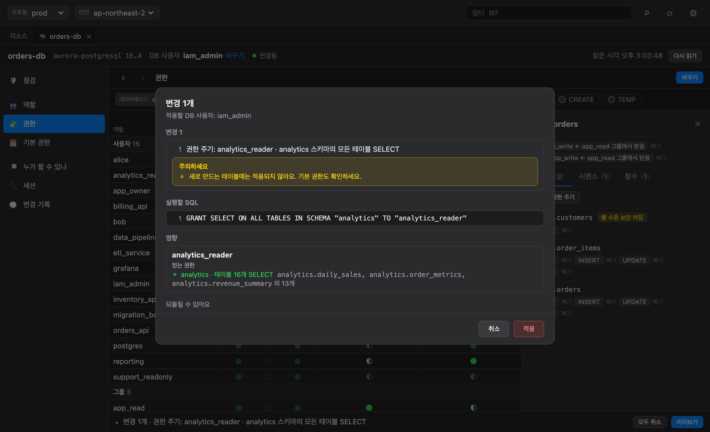

How changes are made:

- **Preview of the exact SQL.** Every change, and every batch from the tray, opens a preview first: the SQL that will run, which roles gain or lose privileges, and warnings. Blocked changes can't be applied; risky ones ask you to type the role name.
- **One transaction per change or batch.** A batch of up to 50 changes runs in a single transaction in one database, with a 5 s lock timeout and a 60 s statement timeout. If anything fails, nothing is applied. A role drop runs one database at a time and says how far it got if it stops.
- **Plans are checked again at apply time.** The app re-reads the cluster and compares the whole preview with the one you saw; if it differs, you get a new preview instead of a surprise.
- **Change log and undo.** Every change is recorded locally (`db-changes.jsonl`, with the user it ran as and the SQL), and most can be undone through the same preview. Dropping a role and ending a session can't be undone.
- **Passwords are shown once.** A new password is generated by the app (24 random characters), sent to the server only as a SCRAM-SHA-256 hash, and shown in a window you can copy from. It is never written to the change log, a notice, or the preview.

The DB user you sign in as needs rights for what you change:

- `CREATEROLE` or `rds_superuser` to manage roles. On PostgreSQL 16 and later it also needs ADMIN OPTION on each role it changes (a role it creates gets that automatically).
- To grant or revoke privileges on objects: be the object's owner (or inherit the owner's privileges), or hold the privilege WITH GRANT OPTION.
- To end other users' sessions: `pg_signal_backend`. Superuser sessions and the app's own connections can't be ended.
- Setting passwords and expiry dates needs `rds_password` when `rds.restrict_password_commands` is on.
- A read replica can't be changed at all. When changing is off, the buttons are disabled and say why.

### Valkey and Redis OSS (ElastiCache)
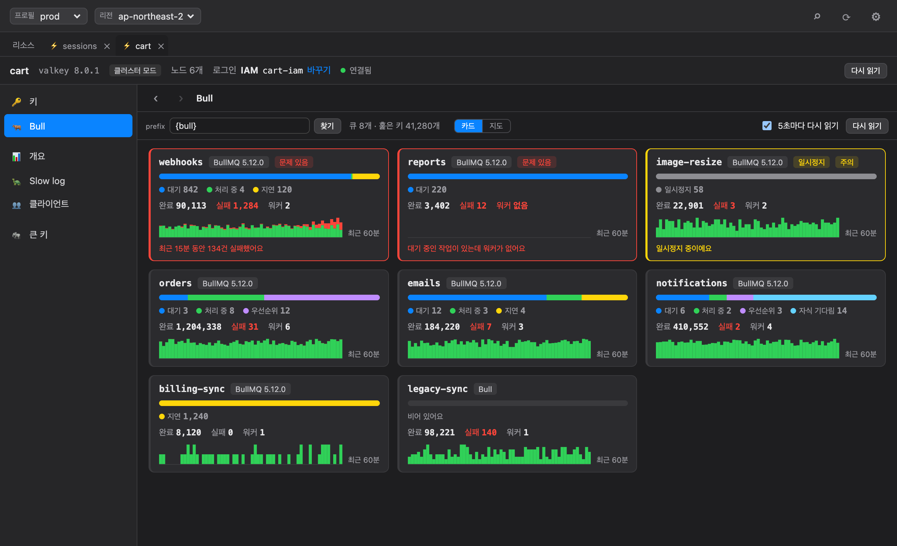

Double-click a Valkey or Redis OSS row in **ElastiCache → Replication Groups** or **Serverless Caches** to open a `⚡` tab (a node in **Cache Clusters** opens its replication group; Memcached can't be opened). The tab connects straight to the cache and **only reads**: every command goes through one allow-list of read commands, and `KEYS` is never sent. Closing the tab closes its connections.

**Signing in**

- Four ways, preselected from the cache's settings: no login, AUTH token, RBAC user and password (a user that needs no password leaves it empty), or IAM. When the cache has a user group, the users and how they sign in are listed to pick from.
- IAM signs a fresh token for every connection (`elasticache:Connect`, Valkey 7.2+ or Redis OSS 7.0+ with TLS) and reconnects when the 12-hour session ends. Tokens are never shown or stored.
- The way and user (and the DB number for caches without cluster mode) are remembered per cache. Passwords are kept in the macOS keychain only when **비밀번호 기억하기** is on, and **저장한 비밀번호 지우기** removes them.
- TLS is used when the cache encrypts in transit, checked against the macOS system roots with host name verification. Cluster-mode caches and serverless caches follow the slot map; caches without cluster mode read from the reader endpoint when there is one.

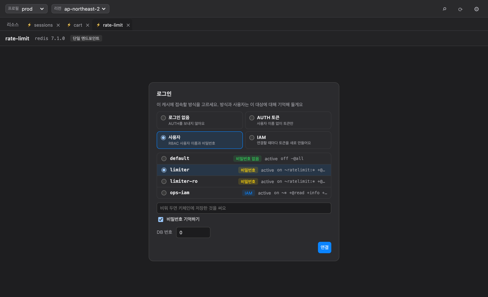

**Keys and values**

- **🔑 키**: keys read with `SCAN` a page at a time across every shard, grouped into a tree by a delimiter (`:` by default), with folder counts, type badges, and TTLs. Filter by `SCAN` pattern and type; **더 읽기** continues. The top line shows how many keys were read out of about how many in total.
- A key's detail shows its type, TTL with the expiry time, length, memory (`MEMORY USAGE`), and encoding. Strings are read up to 1 MiB and shown as text, a collapsible JSON tree, or hex and Base64 for binary data. Hashes, sets, and sorted sets come 200 at a time, lists from the front, streams with a summary and 100 entries, and RedisJSON values as JSON. Binary key names work too. Values stay in memory; nothing is written to disk.

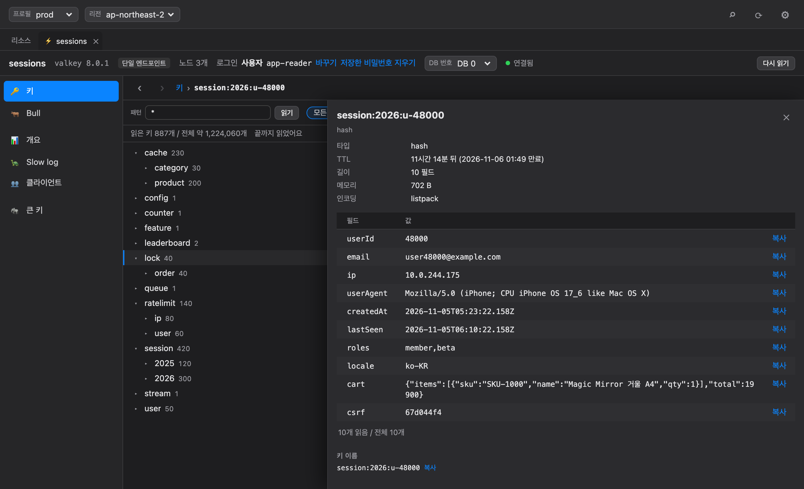

**Server**

- **📊 개요**: memory against `maxmemory`, peak and fragmentation, hit ratio, commands per second, clients, evicted and expired keys, uptime, and replication lag, plus a node table (role, shard, slots) and the keyspace per DB.
- **Topology graph** (in 📊 개요): shards as groups, primary → replica edges labelled with replication lag, slot ranges, memory and commands per node, and the client hosts (top 20 by connections, the rest folded) linked to the nodes they use.
- **🐢 Slow log** (`COMMANDLOG` on Valkey 8.1+, else `SLOWLOG`), **👥 클라이언트** (`CLIENT LIST`, with the app's own connections marked), and **🐘 큰 키**: samples up to 5,000 keys and ranks the 50 largest by `MEMORY USAGE`, with progress and **중단**.
- **👥 클라이언트** has **표 | 지도**: the map links client hosts to connection names, and on to the nodes when there are several. Bull and BullMQ connections (`<prefix>:<base64 queue name>`) are shown by queue name, so producers and workers of one queue share a box. The search filters both.
- Serverless caches block `SLOWLOG`, `CLIENT LIST`, `MEMORY`, and `OBJECT`: those screens are turned off with the reason, and big keys are ranked by length instead.

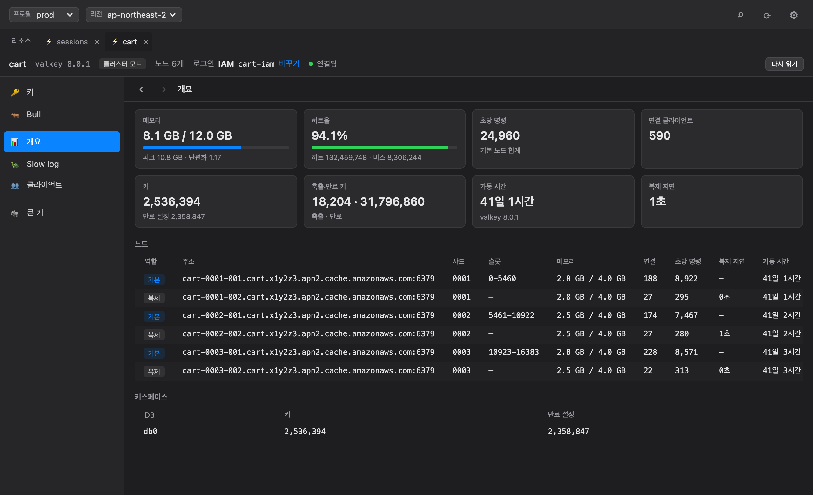

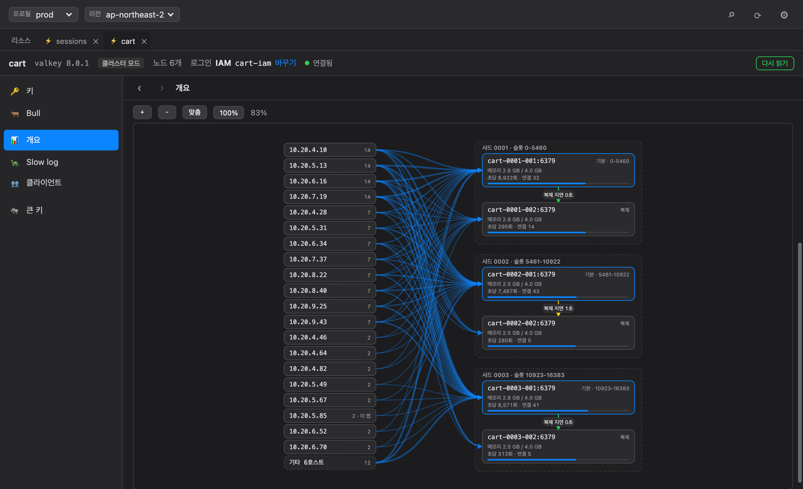

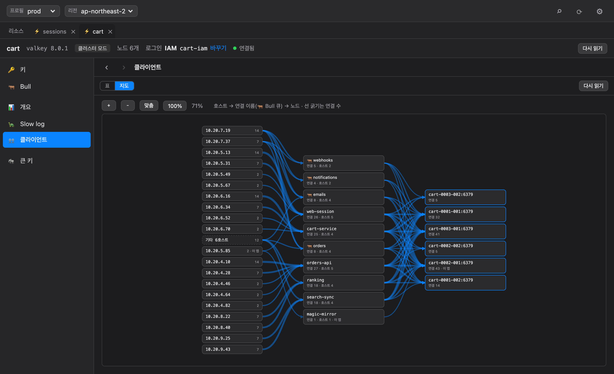

**🐂 Bull**

BullMQ and the older Bull keep each queue in plain keys (`<prefix>:<queue>:wait`, `:active`, `:delayed`, `:completed`, `:failed`, `:meta`, job hashes, …). This screen reads them and draws the queues; it never retries, removes, or pauses anything.

- Enter the prefix (`bull` by default, `{bull}` and the like for hash-tagged cluster queues; a trailing `:` is ignored; remembered per cache) and the app finds the queues in one bounded `SCAN` pass over the `:meta` and `:id` keys (50,000 keys per call — about 44 ms of server time on an ElastiCache node, kept under 50 ms so workers aren't held up — up to 20 s or 5,000,000 keys, then **이어서 찾기**). A server with 400,000 keys, mostly job hashes, is searched in about 2 s over a 65 ms link.
- **Queue cards**: counts per state as a stacked bar (waiting, active, delayed, prioritized, waiting for children, paused), completed and failed totals, workers (from `CLIENT LIST` connection names), and a 60-minute sparkline of completed and failed jobs. Queues with waiting jobs and no workers, or with many recent failures, come first with a red border; paused queues, backlogs of 1,000 or more, or a failure rate of 2% or more get a yellow one. While shown, the cards reload every 5 seconds by reading only the queues already found; the keyspace is searched again only on **다시 읽기**, a new prefix, or a full refresh.
- While a connection is open, the app keeps what can't change: the per-minute counts of minutes that are over (only the last open minutes are counted again on each reload) and the times and failure reason of each finished job, keyed by its finish time so a retried job is read again. Reconnecting, or switching login or database, starts empty.
- **Queue map** (**카드 | 지도**): queues as nodes in the cards' health colors, parent → child queue links with job counts (from the `parentKey` of up to 50 recent jobs per queue), and worker hosts linked to the queues they work.
- **Queue detail**: state tiles that open the job table for that state, completed and failed per minute for the last hour (and per 10 minutes for the last day when BullMQ metrics are on), wait and processing time p50/p95 with histograms from the last 100 finished jobs, the oldest waiting job and the next delayed one, failure reasons grouped from the last 100 failures, and the workers.
- **상태 전이**: a graph of how jobs moved between states over the last 15 minutes, hour, or 6 hours, read from the queue's `events` stream (each entry names the event and the previous state). Edge widths and labels are counts; stalled jobs and exhausted retries are highlighted, other events (progress, drained, removed, …) are listed below. The stream is trimmed by BullMQ (`maxLenEvents`), so the panel says when it covers less than the chosen window.
- **Job detail**: a timeline from created to started to finished, attempts, progress, data, options and return value as JSON trees, stack traces, and the last 100 log lines.
- **Flow graph**: for a job in a BullMQ flow, the whole tree from the root parent down — across queues — with each job colored by state and edges marking pending, finished, failed, and ignored children (from `dependencies`, `processed`, `failed`, and `unsuccessful`), up to 300 jobs. Click a job to open it; **크게 보기** gives it the whole pane.
- Both BullMQ and the older Bull are read, including Bull 3's sorted `completed`/`failed` sets and the plain sets of older versions.

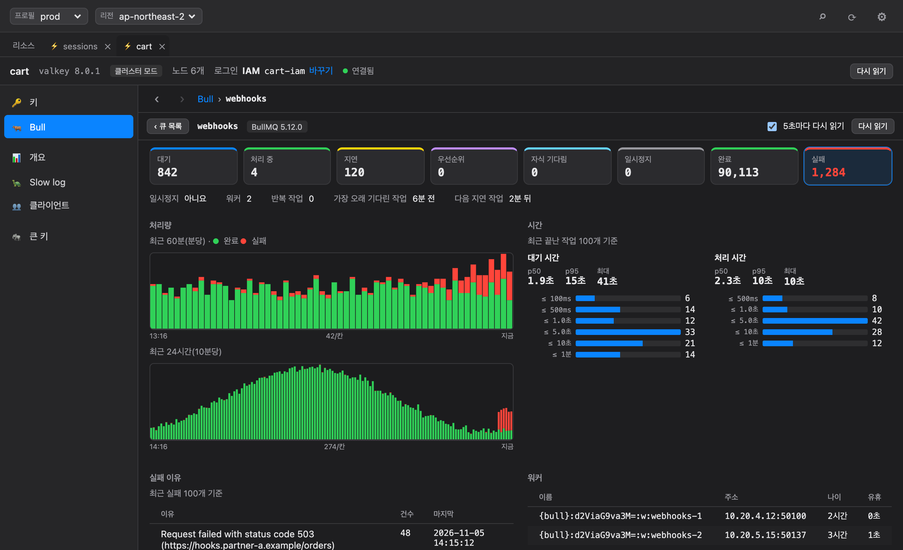

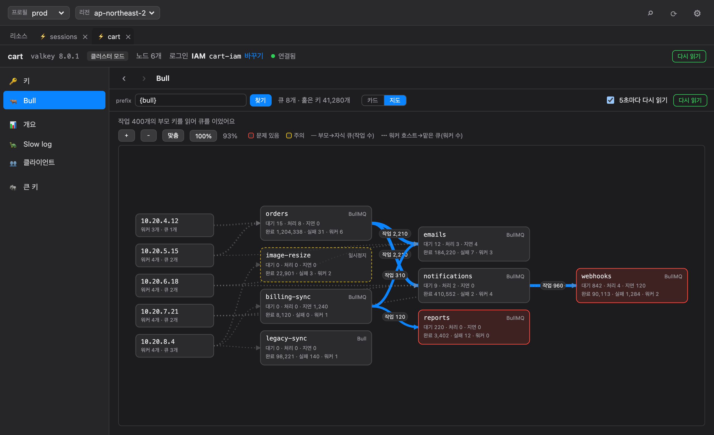

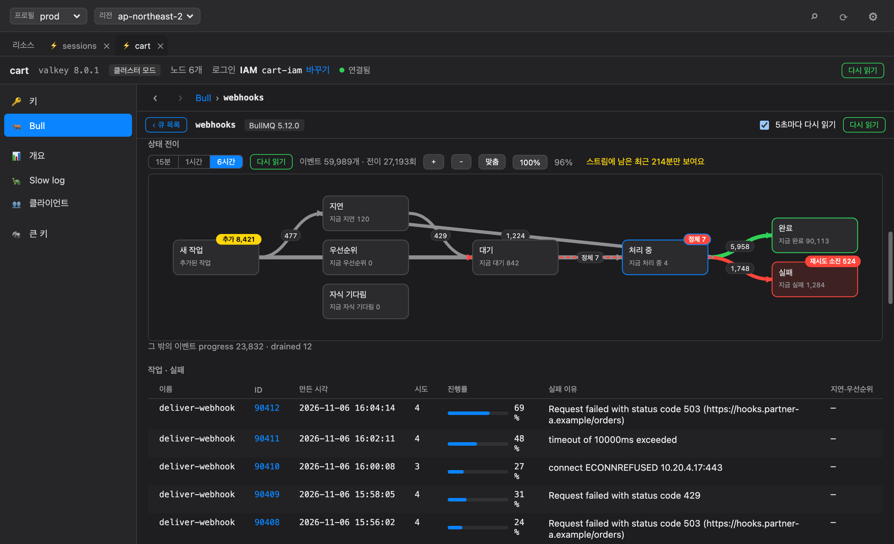

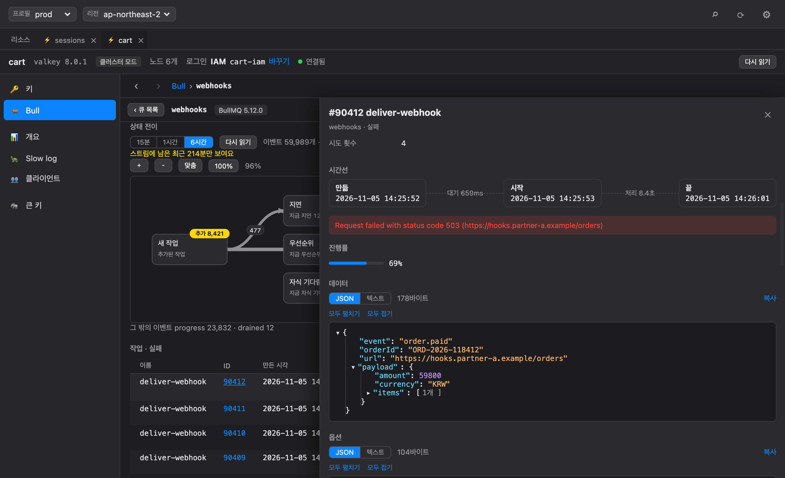

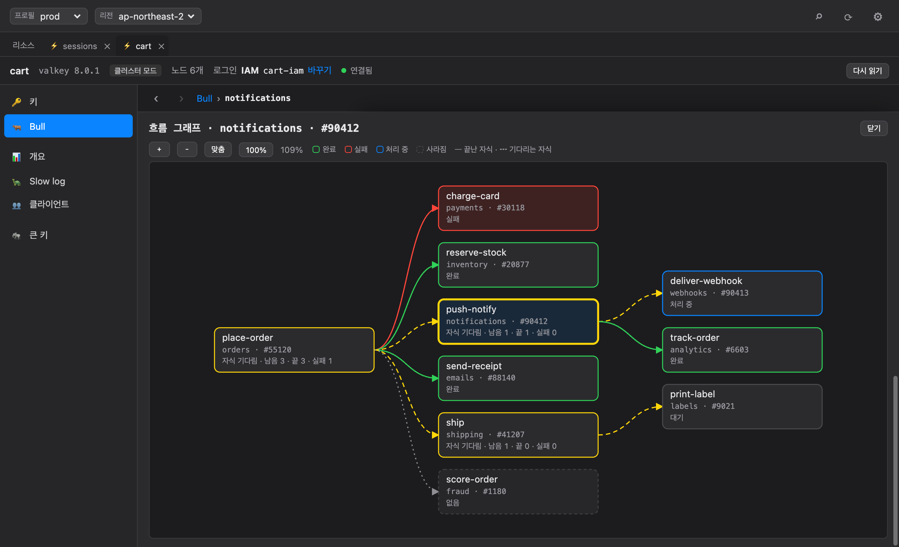

### S3 explorer
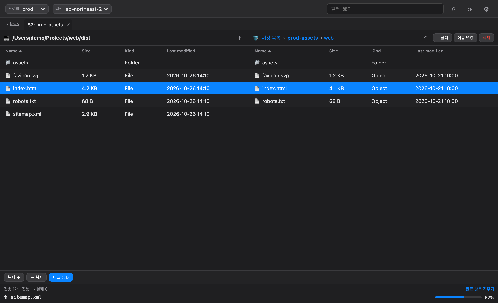

- Double-click a bucket to open it in its own tab. Several buckets can be open side by side.
- Your Mac on the left, S3 on the right (Tab switches panes). Drag and drop between panes, or drop files from Finder onto the S3 pane. The local folder you were in is remembered.
- Upload and download with progress (3 at a time), new folder, rename, delete (⌘⌫).
- Asks before overwriting existing files and before deleting (with an object count).
- Mouse back/forward buttons (e.g. MX Master thumb buttons) and ⌘[ / ⌘] move through folder history, per pane.

### File diff
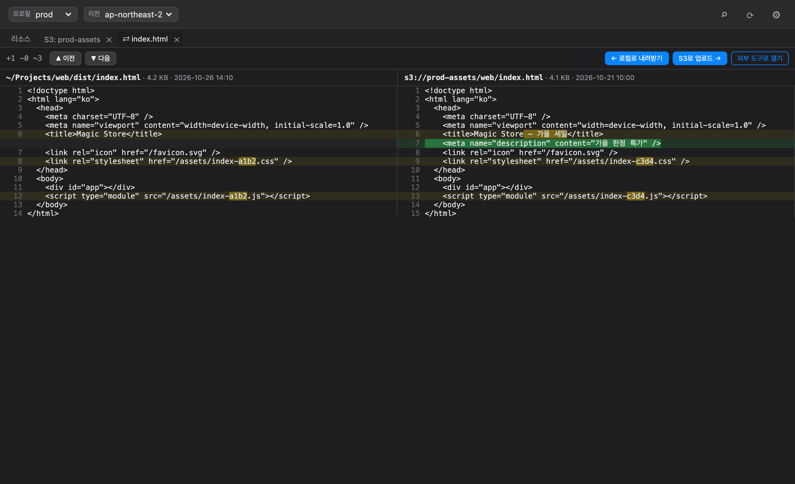

- Compare local↔S3, S3↔S3, or local↔local files with **Compare ⌘D**. The diff opens in its own tab.
- Side-by-side view, inline change highlighting, collapsed unchanged lines, jump between changes (F7 / ⇧F7).
- Reports line-ending-only (CRLF/LF) differences. Binary files and files over 2 MB are compared by size, modified time, and MD5.
- Upload or download straight from the diff, or open it in FileMerge, VS Code, or a custom tool (Settings → 비교 도구). S3 files handed to an external tool are copied to a temporary folder that's cleaned up after an hour.

### Auto-update
The app checks for a new version at launch and every 6 hours, and shows an **Update now / Later** banner. You can also check from Settings → 업데이트. Only updates with a valid signature are installed. Development builds never check.

## What can change things

Everything else in the app only reads. These are the only places that write, and each goes through a preview:

| Where | What it can change | Guards | Log and undo |
| --- | --- | --- | --- |
| IAM workspace | Policy attachments, group members, inline policies, policy versions, access keys | Preview of API calls and permission impact, typed confirmation for risky changes, recheck at apply | `iam-changes.jsonl`, most undoable |
| PostgreSQL tab | Roles, attributes, memberships, privileges, default privileges, passwords, sessions | **Change** switch, SQL preview, typed confirmation for risky changes, one transaction, recheck at apply | `db-changes.jsonl`, most undoable |
| EKS tab | Workloads, CronJobs, Jobs, nodes, any object by YAML, RBAC bindings, EKS access entries, Helm releases, security fixes; shells and port-forwards | RBAC-aware buttons, dry-run preview (`helm --dry-run=server` for Helm), typed name for `kube-system` / `prod` and risky permission changes, stale-preview check | `k8s-changes.jsonl`, many undoable |
| ArgoCD tab | Refresh and sync of applications | Sync sheet with Prune and Dry run | — |
| Argo Workflows tab | Workflows, CronWorkflows, templates, event sources, sensors | Confirmation, typed name for `prod` on stop/terminate/delete | — |
| Tailscale check | This Mac's **accept routes** setting | Shows the `tailscale set` command and asks first | Undo button |
| S3 explorer | Objects (upload, rename, delete, new folder) | Confirmation before overwrite and delete | — |

## Settings

Open with the ⚙ button in the toolbar.

| Setting | Options | Default |
| --- | --- | --- |
| 표시할 서비스 | Which of the 17 services appear in the sidebar. A service added by an update starts turned on; one you turn off stays off | All |
| 화면 테마 | 시스템 설정 따르기, 밝게, 어둡게 | Follow the system |
| 비교 도구 | FileMerge, VS Code, or a custom command with `{left}` and `{right}` (e.g. `ksdiff {left} {right}`) | FileMerge |
| kubeconfig 경로 | A kubeconfig file for the EKS tab | `KUBECONFIG` or `~/.kube/config` |
| 리소스 캐시 | How long resource lists stay fresh: 5 min, 15 min, 1 h, 6 h, unlimited; **캐시 비우기** (⌘⇧R) | 15 min |
| 업데이트 | Current version, check now, update now | — |

## Keyboard shortcuts

| Keys | Where | Action |
| --- | --- | --- |
| ⌘F | Any list | Focus the fuzzy filter (Esc clears it) |
| ⌘K | Anywhere | Find any resource list you've opened |
| ⌘R | Anywhere | Refresh what's on screen (on the cost tab, skip the cost cache) |
| ⌘⇧R | Anywhere | Drop every cached list and reload |
| ⌘C | Resource detail | Copy the ID |
| ↑ / ↓, Enter | Resource list, ⌘K | Move the selection, open it |
| ⌘[ / ⌘], mouse back/forward | Tabs with history, S3 panes | Back / forward |
| Tab | S3 explorer | Switch panes |
| ⌘D | S3 explorer | Compare the selected files |
| ⌘⌫ | S3 explorer | Delete the selection |
| F7 / ⇧F7 | File diff | Next / previous change |
| Arrows, Space, ⇧+arrows, ⌘Home / ⌘End | IAM assignment matrix, PostgreSQL privileges table | Move, toggle, select a range, jump to a corner |
| Tab / ⇧Tab, Esc then Tab | YAML and JSON editors | Indent / outdent; leave the editor |
| Esc | Dialogs, detail overlays | Close (not while the cursor is in an editor) |

## What the app stores

Under `~/Library/Application Support/dev.finallee.magicmirror/`:

| File | Contents | Kept |
| --- | --- | --- |
| `settings.json` | Enabled services and the services the app has already shown, favorites, the sidebar order you dragged, last profile and region, theme, diff tool, kubeconfig path, cache TTL, the explorer's local folder, PostgreSQL sign-in users, ElastiCache sign-in ways and users, DB numbers, and Bull prefixes, EKS contexts, bookmarks, lane widths, and security checks turned off, ArgoCD and Argo Workflows servers and their list filters | Until changed |
| `resource-index.json` | The ⌘K index: names, IDs, column values, tags. No raw JSON or detail fields. Readable only by you | 7 days; wiped by ⌘⇧R |
| `cost-cache.json` | Cost Explorer answers and the monthly request counter | Answers for 6 hours |
| `iam-changes.jsonl` | IAM changes applied from the app, with undo state | Until deleted |
| `db-changes.jsonl` | PostgreSQL changes, with the DB user and SQL (never passwords) | Until deleted |
| `k8s-changes.jsonl` | EKS changes, and when shells and node shells opened and closed (never their input or output, never Secret values) | Until deleted |

- ArgoCD and Argo Workflows API tokens and ElastiCache passwords you chose to remember live only in the macOS keychain (services `magic-mirror.argocd`, `magic-mirror.argo-workflows`, and `magic-mirror.elasticache`).
- AWS credentials are never stored by the app; it uses `~/.aws` and the AWS CLI's SSO cache.
- Saved logs go to `~/Downloads`; files for external diff tools go to `$TMPDIR/magic-mirror-diff/` and are removed after an hour.
- Metrics samples, Secret values you reveal, new PostgreSQL passwords, and cache keys and values are kept in memory only.

## Install

1. Download `Magic-Mirror-<version>-macos-universal.dmg` from [Releases](https://github.com/final-lee/magic-mirror/releases/latest). It runs on Intel and Apple Silicon, macOS 11 or later.
2. Open the dmg and drag **Magic Mirror** into **Applications**.
3. The app is not notarized by Apple, so you have to allow it once:
   - **System Settings → Privacy & Security → Open Anyway**, or
   - run this in Terminal (also when macOS says the app is damaged):
     ```bash
     xattr -dr com.apple.quarantine "/Applications/Magic Mirror.app"
     ```
4. Optionally check the download against the `.sha256` file from the same release:
   ```bash
   shasum -a 256 -c Magic-Mirror-<version>-macos-universal.dmg.sha256
   ```

A Korean install guide is in [docs/INSTALL.md](docs/INSTALL.md) and is attached to every release.

### Requirements

**General**

- A profile in `~/.aws/config`. SSO profiles need the AWS CLI v2 (`aws`), which the app uses to sign in.
- Read permissions for the services you want to browse. The VPC diagram uses EC2 `Describe*` calls plus `rds:DescribeDBInstances`, `elasticloadbalancing:DescribeLoadBalancers`, and `lambda:ListFunctions`; anything it can't read is skipped with a warning. ElastiCache reads `elasticache:DescribeReplicationGroups`, `elasticache:DescribeCacheClusters`, and `elasticache:DescribeServerlessCaches`. Writing from the S3 explorer needs `s3:PutObject` and `s3:DeleteObject`.

**IAM workspace**

- Reading:
  - `iam:GetAccountAuthorizationDetails`, `iam:ListPolicies`, `iam:GetPolicy`, `iam:GetPolicyVersion`
  - `iam:ListAccessKeys`, `iam:GetAccessKeyLastUsed`, `iam:GenerateCredentialReport`, `iam:GetCredentialReport`
  - `iam:GenerateServiceLastAccessedDetails`, `iam:GetServiceLastAccessedDetails`, `iam:SimulatePrincipalPolicy`, `access-analyzer:ValidatePolicy`
  - If one of these is missing, most screens that need it say which action is missing.
- Changing also needs the matching write actions:
  - `iam:AttachUserPolicy`, `iam:AttachGroupPolicy`, `iam:AttachRolePolicy`, and the matching `Detach…Policy`, `Put…Policy`, and `Delete…Policy` actions
  - `iam:AddUserToGroup`, `iam:RemoveUserFromGroup`
  - `iam:CreatePolicyVersion`, `iam:DeletePolicyVersion`
  - `iam:UpdateAccessKey`, `iam:DeleteAccessKey`

**Cost tab**

- `ce:GetCostAndUsage`, `ce:GetCostForecast`, and `ce:ListCostAllocationTags`. Cost Explorer has to be turned on once in the Billing console (it can take up to 24 hours), and in an organization the management account can block member accounts from it.

**EKS tab**

- A kubeconfig context for the cluster (`aws eks update-kubeconfig`), and the tools its exec plugin runs (usually the AWS CLI) on your login shell's `PATH`.
- A network path to the cluster's API endpoint (for a private endpoint, for example over a VPN).
- `eks:DescribeCluster` to find the context. The overview also reads `eks:ListNodegroups`, `eks:DescribeNodegroup`, `eks:ListFargateProfiles`, `eks:ListAddons`, `eks:DescribeAddon`, `eks:DescribeAddonVersions`, and `eks:ListInsights`; whatever is missing is reported in its section.
- **🌐 네트워크** reads `ec2:DescribeInstances`, `ec2:DescribeSubnets`, and `elasticloadbalancing:DescribeLoadBalancers`, `DescribeTags`, `DescribeListeners`, `DescribeRules`, `DescribeTargetGroups`, and `DescribeTargetHealth`.
- **🛡 접근** reads `eks:ListAccessEntries`, `eks:DescribeAccessEntry`, `eks:ListAssociatedAccessPolicies`, `eks:ListPodIdentityAssociations`, `eks:DescribePodIdentityAssociation`, and `iam:GetRole`; changing access entries needs `eks:CreateAccessEntry`, `eks:UpdateAccessEntry`, `eks:DeleteAccessEntry`, `eks:AssociateAccessPolicy`, and `eks:DisassociateAccessPolicy`.
- **🔍 보안 점검** also reads `eks:DescribeClusterVersions` and `ec2:DescribeLaunchTemplateVersions`.
- **⎈ Helm** changes need `helm` 3.13 or later on your login shell's `PATH`.
- Kubernetes RBAC for what you look at (`get`, `list`, `watch`) and change (`patch`, `create`, `delete`, `pods/exec`, `pods/attach`, `pods/portforward`, `pods/eviction`). Usage columns and graphs need metrics-server and read access to `metrics.k8s.io`. The access screen reads roles, bindings, ServiceAccounts, and pods cluster-wide, and its cluster check needs `create subjectaccessreviews`. Helm reads and writes its release Secrets (or ConfigMaps).

**ArgoCD tab**

- Network access to the ArgoCD API server and an API token for an account allowed to read applications and ApplicationSets, and to sync the ones you want to sync.

**Valkey and Redis OSS tab**

- `elasticache:DescribeReplicationGroups`, `DescribeCacheClusters`, and `DescribeServerlessCaches`; `DescribeUserGroups` and `DescribeUsers` to list a user group's users (otherwise you type the user name).
- A network path to the cache endpoint, such as a VPN or Tailscale; serverless public endpoints work directly.
- IAM sign-in needs `elasticache:Connect` on the cache and the ElastiCache user, an IAM-enabled user in the cache's user group, Valkey 7.2+ or Redis OSS 7.0+, and TLS.
- The user needs the read commands each screen uses (`SCAN`, `TYPE`, `PTTL`, the per-type reads, `INFO`, and for the server screens `SLOWLOG`/`COMMANDLOG`, `CLIENT LIST`, `MEMORY USAGE`); a missing one is named in the error.

**Argo Workflows tab**

- Network access to the Argo Server (for example over Tailscale). To sign in with a kubeconfig context, the server must run with `--auth-mode=client` and that identity needs RBAC on the Argo resources it reads or changes; events and IRSA roles also need `list events` and `get serviceaccounts` in those namespaces.

**Tailscale check**

- The Tailscale app (`/Applications/Tailscale.app`) or a `tailscale` CLI on your login shell's `PATH`.

**PostgreSQL tab**

- `rds:DescribeDBClusters`, `rds:DescribeDBInstances`, and `rds-db:connect` for the DB user you sign in as.
- A network path to the database endpoint, such as a VPN. The app connects directly and checks the server certificate against the bundled RDS CA.
- IAM database authentication turned on for the cluster or instance.
- A DB user that is a member of `rds_iam`. Reading works with any such user, though other users' session details also need `pg_read_all_stats`. Changing roles and privileges also needs `rds_superuser` or CREATEROLE (see [Changing roles and privileges](#changing-roles-and-privileges)), and the app says when the user you signed in as has neither.

## Development

| Part | Stack |
| --- | --- |
| App | [Tauri 2](https://tauri.app) |
| Backend | Rust, AWS SDK for Rust, [`kube`](https://crates.io/crates/kube) and `k8s-openapi`, `tokio-postgres` with rustls, [`fred`](https://crates.io/crates/fred) (Valkey/Redis), `reqwest`, `keyring`, [`similar`](https://crates.io/crates/similar) for diffs, `croner` / `chrono-tz` for cron schedules |
| Frontend | React 18, TypeScript, Vite, TanStack Query, CodeMirror 6 (YAML), xterm.js (terminals) |
| Tests | Vitest, Testing Library, `cargo test` |

```bash
npm install
npm run tauri dev      # run in development mode (Vite on port 1420, same data folder as the installed app)
npm run tauri:dev      # same, but on a random free port and with this worktree's own data folder, so several worktrees can run at once
npm run dev            # Vite alone, without the Tauri backend (the screenshot script uses it)
npm run build          # type-check and build the frontend
npm test               # frontend tests
(cd src-tauri && cargo test && cargo clippy --all-targets -- -D warnings)
```

The Rust toolchain is pinned in `rust-toolchain.toml` (with both macOS targets) because of the AWS SDK's minimum supported Rust version. Debug builds pack debug info (`split-debuginfo = "packed"`) and skip it for dependencies, which keeps `src-tauri/target` from growing without bound.

`npm run tauri:dev` picks a free port in 1421-1499 (`DEV_PORT_RANGE=a-b` to change) and gives the app a per-worktree identifier, so settings, the cost cache and request counter, and the IAM, DB, and Kubernetes change logs live in `~/Library/Application Support/dev.finallee.magicmirror.dev-<worktree>-<hash>/`. On first run it copies `settings.json` from the installed app's folder. Changes made there can't be undone from another worktree or from the installed app, and the cost cache isn't shared, so the same view costs a Cost Explorer request in each worktree. Switching between `tauri dev` and `tauri:dev` in one worktree recompiles the app crate. Dev builds never check for updates.

### Live tests

Tests that need real servers are `#[ignore]`d in a normal `cargo test` and run through scripts:

| Script | What it tests | Needs |
| --- | --- | --- |
| `scripts/k8s-live-test.sh` | The EKS tab against two [kind](https://kind.sigs.k8s.io) clusters (default `kindest/node:v1.33.1` and `v1.35.0`; override with `KIND_IMAGES`), including a restricted ServiceAccount, CRDs, shells, port-forwards, drain, and the access, RBAC change, network, security check, and Helm fixtures in `scripts/k8s-live/` | Docker, `kind`, `kubectl`, `yq`, `jq`, `helm` |
| `scripts/pg-live-test.sh` | The PostgreSQL catalog reads and changes against PostgreSQL 14 and 16 containers on `127.0.0.1:55414` / `55416`, removed when it ends | Docker |
| `scripts/kv-live-test.sh` | The Valkey/Redis tab against Valkey 8 containers: a plain server with every value type, BullMQ-, Bull 3-, and older Bull-shaped queues, a two-queue flow and an events stream, an AUTH and ACL server (password, no-password, and restricted users), a TLS server with a CA made for the run, and a three-shard cluster; removed when it ends | Docker, `openssl` |
| `scripts/cost-live-test.sh <profile>` | The cost commands against a real account; about 3 Cost Explorer requests (≈ $0.03) | An AWS profile with Cost Explorer access |

### Maintenance scripts

- `node scripts/update-iam-catalog.mjs` regenerates `src-tauri/src/iam/catalog.json` (every IAM action and its access level) from the AWS Service Reference. Needs Node 20+ and internet access.
- `scripts/screenshots/shoot.mjs` retakes every README screenshot from a demo page that runs the real frontend against mocked backend commands (`demo.tsx` plus one mock module per area: `iam.ts`, `cost.ts`, `k8s.ts`, `argocd.ts`, `argowf.ts`, `pg.ts`). Run `npm run dev`, then `npm i --no-save playwright-core && node scripts/screenshots/shoot.mjs [out_dir] [section…]` (needs Google Chrome). Sections are `core`, `k8s`, `argocd`, and `pg`; with none it takes them all.

### Project layout
```
src/                     React frontend
  App.tsx                tabs, toolbar, global shortcuts
  api/                   Tauri command wrappers, shared types, queries
  components/            resource browser, sidebar, ⌘K palette, tab bar, settings, SSO and update banners
  lib/                   fuzzy match, theme, overlay scrollbars, history, SSO login, updater
  explorer/              S3 explorer, transfer queue, diff tab
  vpcmap/                VPC network diagram
  iam/                   IAM workspace
  cost/                  cost dashboard tab
  k8s/                   EKS tab; access/, network/, helm/, rbac/, security/ for those screens
  argocd/                ArgoCD tab
  argowf/                Argo Workflows tab
  pg/                    PostgreSQL users tab
  kv/                    Valkey and Redis OSS tab, including the Bull screens
  tailscale/             Tailscale connection check shown inside network error boxes
src-tauri/src/
  adapters/              per-service read-only adapters for the resource browser
  aws/                   profiles, SDK configs, SSO sign-in
  resource_index.rs      the on-disk ⌘K index
  settings.rs            settings.json
  explorer/              local files, S3 writes and transfers, diff engine, external diff tools
  topology/              VPC topology queries (read-only)
  iam/                   IAM snapshot, permission evaluation, checks, change previews
  iam/write.rs           the only place that calls IAM write APIs
  cost/                  Cost Explorer client, on-disk answer cache and request counter, overview and breakdown shaping (read-only)
  k8s/                   kubeconfig and context matching, connection, reads and watches, logs, shells, node shell, port-forward, change previews and commits, drain, change log; access/ (RBAC and access policy evaluation), rbac/, network/, helm/ (runs the helm CLI), checks/ (security checks)
  argocd/                ArgoCD API client with keychain tokens, application shaping
  argowf/                Argo Server client, kubeconfig-context and keychain auth, response shaping, cron next runs, log streams
  pg/                    PostgreSQL connection, read-only catalog snapshot, privilege evaluation, security checks, change previews and commits
  kv/                    ElastiCache target and sign-in (IAM tokens, keychain), fred connection and topology, the read-only command allow-list, keys, values, server stats, Bull queues
  tailscale/             Tailscale connection check: runs the local CLI (cli.rs is the only place that starts it), pure decision over its output
  jsonl.rs               the shared change-log file format
  mouse_nav.rs           macOS mouse back/forward buttons
scripts/                 dev runner, release, live tests, IAM catalog updater, screenshots
docs/                    install guide, manual test checklist, design specs and plans
```

### Releasing
1. Bump `version` in `src-tauri/tauri.conf.json`, `package.json`, and `src-tauri/Cargo.toml` (and their lock files), commit, and push to `main`. The release tag comes from `tauri.conf.json`.
2. Run `npm run release -- --publish`. It refuses to run with uncommitted changes, when `HEAD` isn't `origin/main`, or when the release already exists. It runs the frontend tests, builds a universal binary, ad-hoc signs and verifies it, signs the update bundle, and creates the GitHub release `v<version>` with the dmg, its `.sha256`, the update bundle, `latest.json`, and `INSTALL.md`. Without `--publish` it only builds into `release/`.

The update signing key must be at `~/.tauri/magic-mirror.key` (or `TAURI_SIGNING_KEY_FILE`). Only the public key is in the repository.
