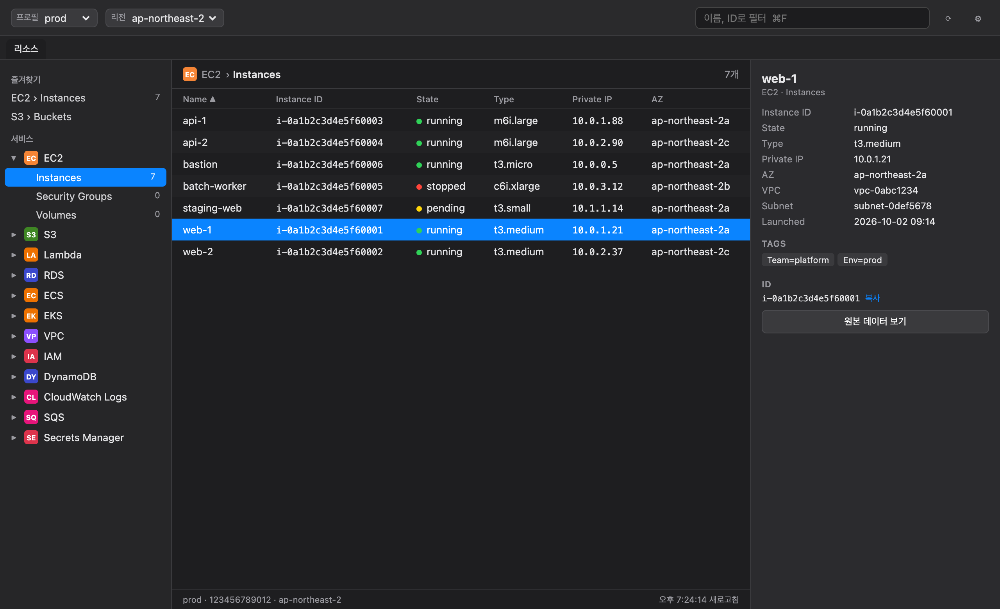
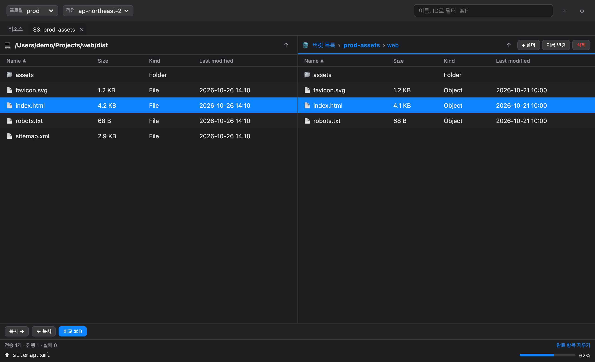
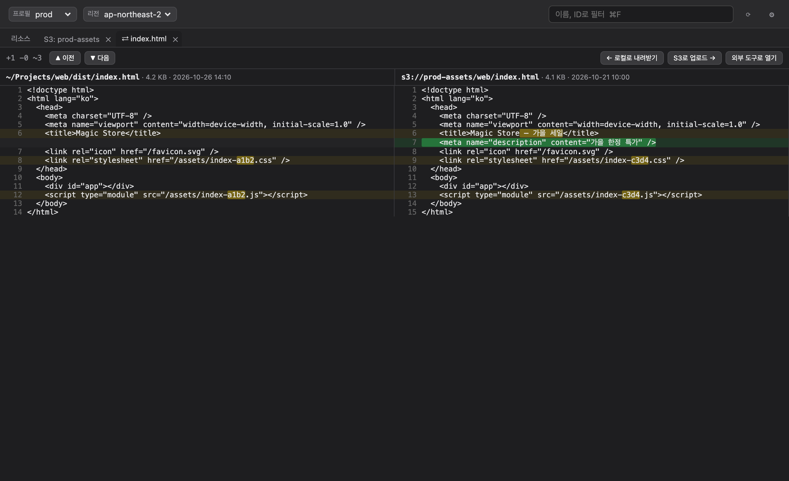

# 🪞 Magic Mirror

> 거울아 거울아, 이 세상에서 AWS 리소스를 제일 빨리 보여주는 건 누구니?

AWS 콘솔에 로그인하고 리전을 바꾸고 메뉴를 몇 번씩 누르거나, 복잡한 CLI 명령을 치지 않고도
**서비스별 리소스를 한 화면에서 훑어보는** macOS 데스크탑 앱이에요. Forklift처럼 S3 버킷과 내 Mac을
두 패널로 놓고 파일을 주고받고, 로컬 파일과 S3 파일이 어떻게 다른지 바로 비교할 수 있어요.



## 주요 기능

### 리소스 브라우저 (읽기 전용)
- **16개 서비스**: EC2 · S3 · Lambda · RDS · ECS · EKS · VPC · IAM · DynamoDB · CloudWatch Logs · CloudFront · SQS · SNS · ECR · Route 53 · Secrets Manager
- `~/.aws/config`의 프로필(SSO 포함)과 리전을 골라서 바로 조회해요. SSO 세션이 만료되면 앱에서 다시 로그인할 수 있어요.
- 자주 쓰는 서비스만 켜두고, 리소스 타입을 즐겨찾기에 고정할 수 있어요.
- 상세 패널: 주요 필드, 태그, 원본 JSON, AWS 콘솔로 바로 가기, ID 복사(⌘C)
- 이름·ID 필터(⌘F), 새로고침(⌘R)
- 조회만 해요. 리소스를 바꾸는 API는 부르지 않고, Secrets Manager의 비밀 값도 읽지 않아요.

### S3 탐색기


- 리소스 탭에서 버킷을 **더블클릭**하면 `S3: 버킷` 탭이 열려요. 버킷마다 탭을 나란히 열어둘 수 있어요.
- 왼쪽은 내 Mac, 오른쪽은 S3. 패널 사이 **드래그 앤 드롭**, Finder에서 S3 패널로 바로 끌어다 놓기
- 업로드·다운로드(진행률 표시, 동시 3개), 새 폴더, 이름 변경, 삭제
- 같은 이름이 있으면 덮어쓸지 묻고, 삭제는 개수를 보여주고 확인을 받아요.
- 마우스 뒤로/앞으로 버튼(MX Master 엄지 버튼 등)과 ⌘[ / ⌘]로 폴더 이동 기록을 오가요.

### 파일 비교


- 로컬↔S3, S3↔S3, 로컬↔로컬 파일을 골라 **비교 ⌘D** → 비교 탭이 열려요.
- 나란히 보기, 줄 안 변경 강조, 같은 줄 접기, 변경 위치 이동(F7 / ⇧F7)
- 줄바꿈(CRLF/LF)만 다른 경우도 알려줘요. 바이너리나 2MB가 넘는 파일은 크기·수정일·MD5로 비교해요.
- 비교 화면에서 바로 업로드·내려받기, FileMerge·VS Code·직접 지정한 도구로 열기

### 자동 업데이트
켤 때와 6시간마다 새 버전을 확인하고 **"지금 업데이트 / 나중에"** 배너로 알려줘요. 업데이트 파일은 서명이 확인된 것만 설치해요.

## 설치

1. [Releases](https://github.com/final-lee/magic-mirror/releases/latest)에서 `Magic-Mirror-<버전>-macos-universal.dmg`를 받아요. Intel과 Apple Silicon 모두 지원하고, macOS 11 이상이 필요해요.
2. dmg를 열고 **Magic Mirror**를 **Applications**로 옮겨요.
3. Apple 공증을 받지 않은 앱이라 처음 한 번만 실행을 허용해야 해요.
   - **시스템 설정 → 개인정보 보호 및 보안 → "그래도 열기"**, 또는
   - 터미널에서 실행:
     ```bash
     xattr -dr com.apple.quarantine "/Applications/Magic Mirror.app"
     ```

자세한 내용은 [INSTALL.md](docs/INSTALL.md)를 보세요.

### 준비물
- `~/.aws/config`에 프로필이 있어야 해요. SSO 프로필은 `aws sso login --profile <이름>`이나 앱의 로그인 버튼으로 로그인해요.
- 조회하려는 서비스의 읽기 권한이 필요해요. S3 탐색기에서 쓰기를 하려면 `s3:PutObject` · `s3:DeleteObject` 권한이 필요해요.

## 개발

| 구성 | 기술 |
| --- | --- |
| 앱 | [Tauri 2](https://tauri.app) |
| 백엔드 | Rust · AWS SDK for Rust · [`similar`](https://crates.io/crates/similar)(비교) |
| 프론트엔드 | React 18 · TypeScript · Vite · TanStack Query |
| 테스트 | Vitest · Testing Library · `cargo test` |

```bash
npm install
npm run tauri dev      # 개발 모드로 실행
npm test               # 프론트엔드 테스트
(cd src-tauri && cargo test && cargo clippy --all-targets -- -D warnings)
```

Rust 툴체인은 `rust-toolchain.toml`에 고정돼 있어요(AWS SDK 최소 버전 때문).

### 프로젝트 구조
```
src/                     React 프론트엔드
  components/            리소스 브라우저, 탭 바, 설정, 업데이트 배너
  explorer/              S3 탐색기 · 전송 대기열 · 비교 탭
src-tauri/src/
  adapters/              서비스별 조회 어댑터 (읽기 전용)
  explorer/              로컬 파일 · S3 쓰기/전송 · 비교 엔진
  mouse_nav.rs           macOS 마우스 뒤로/앞으로 버튼
scripts/release.sh       유니버설 빌드 + GitHub 릴리즈
scripts/screenshots/     README 스크린샷용 데모(가짜 데이터)
```

### 릴리즈
1. `src-tauri/tauri.conf.json`의 `version`을 올리고 main에 push해요.
2. `npm run release -- --publish`를 실행해요. 유니버설 빌드, ad-hoc 서명, 업데이트 파일 서명, GitHub Release 생성(`latest.json` 포함)까지 한 번에 해요.

업데이트 서명 키는 `~/.tauri/magic-mirror.key`에 있어야 해요(저장소에는 공개 키만 있어요).

### 스크린샷 다시 찍기
가짜 데이터로 돌아가는 데모 페이지가 있어요. `npm run dev`로 띄운 뒤 아래를 실행해요(Google Chrome 필요).
```bash
npm i --no-save playwright-core && node scripts/screenshots/shoot.mjs
```
