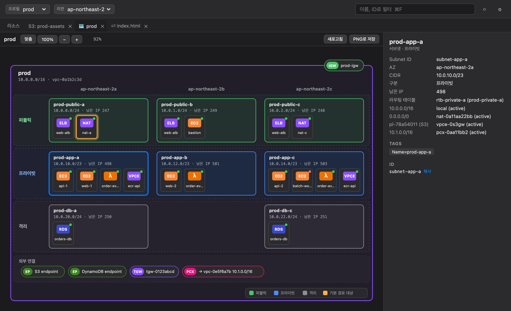
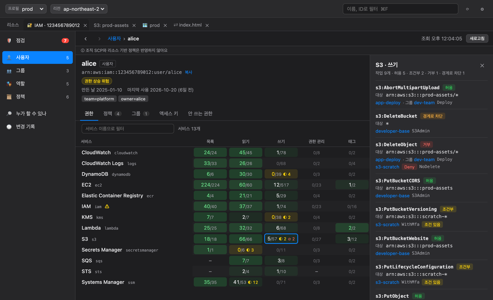

# 🪞 Magic Mirror

> Mirror, mirror on the wall — who shows my AWS resources fastest of all?

A macOS desktop app for browsing AWS resources by service, without clicking through the console or typing long CLI commands. It also has a Forklift-style two-pane S3 explorer, a side-by-side file diff, and an IAM workspace that shows who can do what and lets you fix it safely.


## Features

### Resource browser (read-only)
- **16 services**: EC2, S3, Lambda, RDS, ECS, EKS, VPC, IAM, DynamoDB, CloudWatch Logs, CloudFront, SQS, SNS, ECR, Route 53, Secrets Manager
- Uses the profiles in `~/.aws/config`, including SSO. Pick a profile and region and the list loads.
- When an SSO session has expired — when you pick the profile, when the app starts, or while you work — the app runs `aws sso login` for you. Approve it in the browser that opens and the lists reload. A banner shows the progress and lets you cancel. Profiles that share an SSO session sign in once, and role profiles sign in through their `source_profile`.
- Turn on only the services you use, and pin resource types as favorites.
- Detail panel with key fields, tags, raw JSON, a link to the AWS console, and ID copy (⌘C)
- Filter by name or ID (⌘F), refresh (⌘R)
- Read-only: it never calls APIs that change resources, and it never reads Secrets Manager secret values.

### VPC network diagram


- Double-click a VPC in **VPC → VPCs** to draw its network in a new tab, laid out like an AWS architecture diagram: Availability Zones as columns, public / private / isolated subnets as rows.
- Subnet tiers come from the route tables: a default route to an internet gateway means public, any other default route means private, and no default route means isolated.
- Shows EC2 instances, NAT gateways, load balancers, RDS, Lambda functions, and interface endpoints inside their subnets. Internet, egress-only, and VPN gateways sit on the VPC border. Gateway endpoints, Transit Gateway attachments, and peering connections sit in the bottom band.
- Click a subnet to see its route table and highlight where its default route goes. Click any resource for details and a console link.
- Zoom and pan, and save the diagram as a PNG.

### IAM workspace


Open **IAM → 🔐 IAM 관리** in the sidebar, or double-click a user, role, or policy in the resource list, to get one tab for the whole account.

- **Effective permissions**: for every user, group, and role, a table of services × access levels (list, read, write, permissions management, tagging). It combines attached and inline policies, group policies, permissions boundaries, Deny statements, and conditions. Click a cell to see each action, the resources it covers, and the policy statement that allows or blocks it.
- **Who can do this?**: enter an action such as `s3:DeleteObject`, optionally with a resource ARN, to list every user and role that can perform it and why. You can check the results against the IAM policy simulator.
- **Security checks**: root access keys and MFA, console users without MFA, old or unused access keys, inactive users and roles, admin-level principals, privilege-escalation paths, roles that other accounts or anyone can assume, and policies attached nowhere. Each finding links to the principal, and an old or unused access key can be deactivated right from its finding, through the same preview as any other change.
- **Unused permissions**: uses IAM last-accessed data to show the services a user or role hasn't used, suggest policies to detach, and draft a narrower policy from what was actually used. The draft never allows more than the principal can do today: it leaves out conditional allows and keeps existing Deny statements.
- **Changes from the app**:
  - Attach or detach managed policies, add or remove group members, and create, edit, or delete inline policies.
  - Save a new version of a customer managed policy.
  - Deactivate, reactivate, or delete access keys.
- **Preview before every change**: every change starts with a preview of the exact API calls, who gains or loses which permissions, and any warnings. Risky changes ask you to type the target's name or key ID: granting admin access, cutting off the app's own access, adding or removing a policy whose document couldn't be read, or any change to the app's own access while such a policy is involved. Other unreadable policies are shown as a warning. (For a profile that assumes a role through `source_profile`, the source profile's access key isn't recognized as the app's own key.) When you apply, the app recomputes the change and stops if it no longer matches the preview you confirmed. Service-linked and IAM Identity Center roles are managed by AWS and can't be changed.
- **Assignment matrix** (🧩 할당): two tables, principals × managed policies and users × groups. Click a cell, drag across cells, or use the keyboard (arrows, Space, Shift+arrows for a range) to queue attaches, detaches, and membership changes in a tray of up to 50. Cells a principal only gets through a group show which group grants them and can't be toggled. "다른 주체와 같게" copies another principal's policies or groups; removals are opt-in. The tray is previewed as one batch: per-change API calls, the combined permission changes, and one confirmation if anything is risky. Applying goes change by change, grants first, and stops at the first failure, keeping what was already applied and offering to undo it.
- **Change log**: every applied change is recorded locally, and most can be undone. An undo goes through the same preview. Changes AWS can't reverse, such as deleting an access key, are marked as such. A batch from the assignment matrix shows as one group and can be undone as a whole.
- **What it doesn't evaluate**: only identity-based policies and permissions boundaries. Organization SCPs and resource-based policies (such as bucket policies) aren't included, and the app says so on screen.

### PostgreSQL users (RDS)

Double-click an Aurora PostgreSQL or RDS for PostgreSQL row in **RDS → DB Clusters** or **DB Instances** to open a `🐘` tab (an Aurora instance opens its cluster). The app connects straight to the database over TLS and signs in with an IAM authentication token. Reading is always read-only: every query that looks at the database runs in a read-only transaction. Changes are made only when you press **Apply** on a preview (see below). Closing the tab closes its connections.

- **Roles**: users and groups, with system roles hidden until you ask. Badges mark admin-level roles (`rds_superuser` members), IAM sign-in, CREATEROLE, CREATEDB, BYPASSRLS, REPLICATION, and logins that are expired or about to expire. A role's detail shows its attributes, per-role settings, memberships (including ones that don't inherit), privileges and owned objects per database, and its sessions.
- **Privileges**: a roles × schemas table for one database, with USAGE, CREATE, and table read/write coverage per cell, plus CONNECT, CREATE, and TEMP on the database itself. It counts what a role gets from ownership, direct grants, groups, PUBLIC, and predefined roles such as `pg_read_all_data`, and flags privileges a role can't actually use because it lacks CONNECT or USAGE. Click a cell to see each object's privileges and where each one comes from.
- **Default privileges**: what new objects will get (`ALTER DEFAULT PRIVILEGES`), written out as sentences.
- **Who can do this?**: pick an object and a privilege to list the users and groups that have it, with the path that gives it to them (for example `alice ← app_write ← app_read ← direct grant`).
- **Sessions**: current connections with role, database, client, application, state, start time, and wait event. The app's own connections are marked. Details of other users' sessions need `pg_read_all_stats`, and the app says so when they are hidden.
- **Security checks**: PUBLIC with CREATE on a schema or privileges on tables, `rds_superuser` members, CREATEROLE, BYPASSRLS, expiring logins, login roles with no group and no privileges, gaps in default privileges, SECURITY DEFINER functions without a fixed `search_path`, and `md5` password encryption. Each finding links to the role or to the privileges table. Password hash types and last logins aren't visible on RDS, so they aren't checked, and the app says so.

#### Changing roles and privileges

Turn on **Change** in the bar above a screen to edit. You can:

- **Create a role** (a user or a group), optionally with a preset (read-only, read-write, owner, or admin) on chosen schemas. The app suggests an existing group with the same privileges, or a new one, and sets default privileges for the roles that create tables.
- **Reset a password**, **drop a role** safely (ownership is handed to another role and privileges are removed in every database first, step by step), **end a session**, change attributes, add or remove group members (with ADMIN OPTION), and grant or revoke privileges. On the privileges table you can brush grants and revokes over cells; each click queues a change in the tray at the bottom.

How changes are made:

- **Preview of the exact SQL.** Every change, and every batch from the tray, opens a preview first: the SQL that will run, which roles gain or lose privileges, and warnings. Blocked changes can't be applied; risky ones ask you to type the role name.
- **One transaction per change or batch.** A batch of up to 50 changes runs in a single transaction in one database, with a 5 s lock timeout and a 60 s statement timeout. If anything fails, nothing is applied. A role drop runs one database at a time and says how far it got if it stops.
- **Plans are checked again at apply time.** The app re-reads the cluster and compares the whole preview with the one you saw; if it differs, you get a new preview instead of a surprise.
- **Change log and undo.** Every change is recorded locally (with the user it ran as and the SQL), and most can be undone through the same preview. Dropping a role and ending a session can't be undone.
- **Passwords are shown once.** A new password is generated by the app (24 random characters), sent to the server only as a SCRAM-SHA-256 hash, and shown in a window you can copy from. It is never written to the change log, a notice, or the preview.

The DB user you sign in as needs rights for what you change:

- `CREATEROLE` or `rds_superuser` to manage roles. On PostgreSQL 16 and later it also needs ADMIN OPTION on each role it changes (a role it creates gets that automatically).
- To grant or revoke privileges on objects: be the object's owner (or inherit the owner's privileges), or hold the privilege WITH GRANT OPTION.
- To end other users' sessions: `pg_signal_backend`. Superuser sessions and the app's own connections can't be ended.
- Setting passwords and expiry dates needs `rds_password` when `rds.restrict_password_commands` is on.
- A read replica can't be changed at all. When changing is off, the buttons are disabled and say why.

### S3 explorer


- Double-click a bucket to open it in its own tab. Several buckets can be open side by side.
- Your Mac on the left, S3 on the right. Drag and drop between panes, or drop files from Finder onto the S3 pane.
- Upload and download with progress (3 at a time), new folder, rename, delete
- Asks before overwriting existing files and before deleting (with an object count)
- Mouse back/forward buttons (e.g. MX Master thumb buttons) and ⌘[ / ⌘] move through folder history.

### File diff


- Compare local↔S3, S3↔S3, or local↔local files with **Compare ⌘D**. The diff opens in its own tab.
- Side-by-side view, inline change highlighting, collapsed unchanged lines, jump between changes (F7 / ⇧F7)
- Reports line-ending-only (CRLF/LF) differences. Binary files and files over 2 MB are compared by size, modified time, and MD5.
- Upload or download straight from the diff, or open it in FileMerge, VS Code, or a custom tool.

### Auto-update
The app checks for a new version at launch and every 6 hours, and shows an **Update now / Later** banner. Only updates with a valid signature are installed.

## Install

1. Download `Magic-Mirror-<version>-macos-universal.dmg` from [Releases](https://github.com/final-lee/magic-mirror/releases/latest). It runs on Intel and Apple Silicon, macOS 11 or later.
2. Open the dmg and drag **Magic Mirror** into **Applications**.
3. The app is not notarized by Apple, so you have to allow it once:
   - **System Settings → Privacy & Security → Open Anyway**, or
   - run this in Terminal:
     ```bash
     xattr -dr com.apple.quarantine "/Applications/Magic Mirror.app"
     ```

### Requirements
- A profile in `~/.aws/config`. SSO profiles need the AWS CLI v2 (`aws`), which the app uses to sign in.
- Read permissions for the services you want to browse. The VPC diagram uses EC2 `Describe*` calls plus `rds:DescribeDBInstances`, `elasticloadbalancing:DescribeLoadBalancers`, and `lambda:ListFunctions`; anything it can't read is skipped with a warning. Writing from the S3 explorer needs `s3:PutObject` and `s3:DeleteObject`.
- The IAM workspace reads with:
  - `iam:GetAccountAuthorizationDetails`, `iam:ListPolicies`, `iam:GetPolicy`, `iam:GetPolicyVersion`
  - `iam:ListAccessKeys`, `iam:GetAccessKeyLastUsed`, `iam:GenerateCredentialReport`, `iam:GetCredentialReport`
  - `iam:GenerateServiceLastAccessedDetails`, `iam:GetServiceLastAccessedDetails`, `iam:SimulatePrincipalPolicy`, `access-analyzer:ValidatePolicy`
  - If one of these is missing, most screens that need it say which action is missing.
- Making changes in the IAM workspace also needs the matching write actions:
  - `iam:AttachUserPolicy`, `iam:AttachGroupPolicy`, `iam:AttachRolePolicy`, and the matching `Detach…Policy`, `Put…Policy`, and `Delete…Policy` actions
  - `iam:AddUserToGroup`, `iam:RemoveUserFromGroup`
  - `iam:CreatePolicyVersion`, `iam:DeletePolicyVersion`
  - `iam:UpdateAccessKey`, `iam:DeleteAccessKey`
- The PostgreSQL tab needs:
  - `rds:DescribeDBClusters`, `rds:DescribeDBInstances`, and `rds-db:connect` for the DB user you sign in as
  - A network path to the database endpoint, such as a VPN. The app connects directly and checks the server certificate against the bundled RDS CA.
  - IAM database authentication turned on for the cluster or instance
  - A DB user that is a member of `rds_iam`. Reading works with any such user, though other users' session details also need `pg_read_all_stats`. Changing roles and privileges also needs `rds_superuser` or CREATEROLE (see *Changing roles and privileges* above), and the app says when the user you signed in as has neither.

## Development

| Part | Stack |
| --- | --- |
| App | [Tauri 2](https://tauri.app) |
| Backend | Rust, AWS SDK for Rust, [`similar`](https://crates.io/crates/similar) for diffs |
| Frontend | React 18, TypeScript, Vite, TanStack Query |
| Tests | Vitest, Testing Library, `cargo test` |

```bash
npm install
npm run tauri dev      # run in development mode
npm test               # frontend tests
(cd src-tauri && cargo test && cargo clippy --all-targets -- -D warnings)
```

The Rust toolchain is pinned in `rust-toolchain.toml` because of the AWS SDK's minimum supported Rust version.

### Project layout
```
src/                     React frontend
  components/            resource browser, tab bar, settings, update banner
  explorer/              S3 explorer, transfer queue, diff tab
  vpcmap/                VPC network diagram
  iam/                   IAM workspace
  pg/                    PostgreSQL users tab
src-tauri/src/
  adapters/              per-service read-only adapters
  explorer/              local files, S3 writes and transfers, diff engine
  topology/              VPC topology queries (read-only)
  iam/                   IAM snapshot, permission evaluation, checks, change previews
  iam/write.rs           the only place that calls IAM write APIs
  pg/                    PostgreSQL connection, read-only catalog snapshot, privilege evaluation, security checks
  mouse_nav.rs           macOS mouse back/forward buttons
scripts/release.sh       universal build and GitHub release
```

### Releasing
1. Bump `version` in `src-tauri/tauri.conf.json` and push to `main`.
2. Run `npm run release -- --publish`. It builds a universal binary, ad-hoc signs it, signs the update bundle, and creates the GitHub release with `latest.json`.

The update signing key must be at `~/.tauri/magic-mirror.key`. Only the public key is in the repository.
